# 04 · Arquitetura de Negócio — Rota das Pousadas

> **Documento-referência de negócio.** Esta é a principal fonte da verdade sobre
> _o que_ a plataforma faz e _por quê_ — antecede e orienta toda decisão técnica.
> Documentos irmãos: `Architecture.md` (o _como_ técnico), `DesignSystem.md`,
> `DesignFoundations.md`, `AI_RULES.md`.

| Campo | Valor |
|---|---|
| Versão | 1.0 |
| Status | Aprovado como referência |
| Data | 17/07/2026 |
| Responsáveis | CPO · Solution Architect · Staff Engineer |
| Escopo | Documentação de negócio (sem código, sem BD, sem auth) |
| Público | Produto, Engenharia, Design, Comercial, Liderança |

## Sumário

1. [Visão do Produto](#1-visão-do-produto)
2. [Tipos de Usuários](#2-tipos-de-usuários)
3. [Módulos da Plataforma](#3-módulos-da-plataforma)
4. [Regras de Negócio](#4-regras-de-negócio)
5. [Fluxos do Sistema](#5-fluxos-do-sistema)
6. [Entidades do Negócio](#6-entidades-do-negócio)
7. [Matriz de Permissões](#7-matriz-de-permissões)
8. [Jornadas dos Usuários](#8-jornadas-dos-usuários)
9. [Monetização](#9-monetização)
10. [Integrações Futuras](#10-integrações-futuras)
11. [Escalabilidade](#11-escalabilidade)
12. [Roadmap do Produto](#12-roadmap-do-produto)
13. [Princípios do Produto](#13-princípios-do-produto)
14. [Glossário](#14-glossário)

---

## 1. Visão do Produto

### 1.1 Propósito

A **Rota das Pousadas** é o maior ecossistema digital de pousadas do Brasil — uma
plataforma que conecta viajantes a refúgios independentes com curadoria,
tecnologia e alma. Enquanto os grandes marketplaces tratam hospedagem como
_commodity_, a Rota trata cada pousada como uma **história** e cada viagem como
uma **rota** a ser descoberta.

> **Tese central:** o hóspede brasileiro não quer apenas "um quarto"; quer uma
> experiência com identidade — serra, praia, cachoeira, fazenda — e o pequeno
> hoteleiro não quer apenas "aparecer numa lista"; quer uma operação digital
> completa que hoje só grandes redes possuem.

### 1.2 Qual problema resolve

| Dor | Quem sofre | Como a Rota resolve |
|---|---|---|
| Pousadas dependem de OTAs caras e sem relacionamento com o hóspede | Proprietários | Canal próprio, CRM e comissões justas |
| Gestão manual (WhatsApp, caderno, planilha) | Proprietários | Dashboard de reservas, calendário e financeiro |
| Falta de ferramentas de marketing | Proprietários | Marketing assistido por IA, destaques, fidelidade |
| Descoberta ruim: busca genérica, sem curadoria | Viajantes | Home viva por estação + busca por experiência |
| Insegurança na reserva de pequenos estabelecimentos | Viajantes | Avaliações verificadas, pagamento protegido, suporte |
| Experiência fragmentada (reserva, passeios, transporte) | Viajantes | Marketplace de experiências integrado (futuro) |

### 1.3 Clientes vs. Usuários

- **Clientes (quem paga / gera receita):** proprietários de pousadas (assinatura
  e/ou comissão), anunciantes e parceiros de experiências.
- **Usuários (quem usa):** viajantes/hóspedes (lado da demanda) e as equipes
  operacionais das pousadas (lado da oferta). Ver seção 2.

> Em marketplaces de dois lados, **a oferta é o produto e a demanda é o
> combustível**: sem pousadas de qualidade não há viajantes; sem viajantes não há
> pousadas. A estratégia equilibra os dois lados (ver Roadmap).

### 1.4 Diferenciais competitivos

1. **Curadoria + Home viva** — conteúdo que muda com a estação, clima e datas.
2. **Foco em pousadas** (não hotéis/apartamentos): nicho profundo, não genérico.
3. **IA nativa** — concierge para o viajante e copiloto de receita para o dono.
4. **Ferramentas de gestão de nível "rede"** para o pequeno hoteleiro.
5. **Marca com alma brasileira** — estética, tom e curadoria regionais.
6. **Ecossistema** — hospedagem + experiências + fidelidade num só lugar.

### 1.5 Posicionamento da marca

> _"Cada destino tem uma história. Toda grande viagem começa por uma rota."_

- **Categoria:** marketplace de hospedagem com curadoria (premium acessível).
- **Personalidade:** acolhedora, sofisticada, natural, brasileira.
- **Contra quem:** Booking/Airbnb (amplitude sem curadoria) e canais diretos
  amadores (sem tecnologia). A Rota fica no meio virtuoso: **curadoria + tecnologia**.

### 1.6 Visão de 10 anos

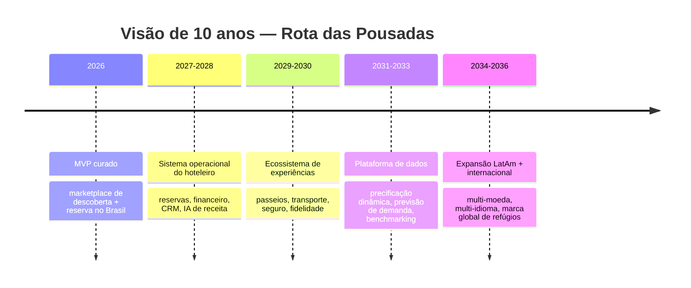

Em 10 anos a Rota deixa de ser "um site de pousadas" e se torna o **sistema
operacional do turismo independente** — a camada de software, distribuição e
dados sobre a qual milhares de pequenos hoteleiros operam.

---

## 2. Tipos de Usuários

Perfis organizados em três domínios: **Demanda** (viajantes), **Oferta**
(pousada) e **Plataforma** (Rota) — mais o **agente de IA**.

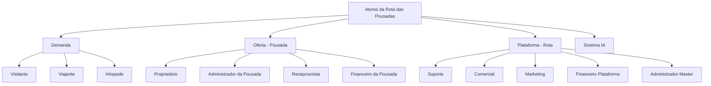

Para cada perfil: **objetivo · permissões · limitações · funcionalidades ·
fluxo**.

### 2.1 Visitante (não autenticado)
- **Objetivo:** descobrir destinos e pousadas, avaliar a proposta de valor.
- **Permissões:** navegar, buscar, ver pousadas, ler avaliações, ler blog.
- **Limitações:** não reserva, não favorita, não avalia, não conversa.
- **Funcionalidades:** home viva, busca, destinos, experiências, detalhe da pousada.
- **Fluxo:** entra → explora → é convidado a criar conta ao tentar reservar/favoritar.

### 2.2 Viajante (autenticado, sem reserva ativa)
- **Objetivo:** planejar viagens, comparar, salvar favoritos, reservar.
- **Permissões:** tudo do visitante + favoritos, wishlist, iniciar reserva, chat, perfil.
- **Limitações:** não gerencia pousadas; só acessa suas próprias reservas.
- **Funcionalidades:** favoritos, alertas de preço/estação, concierge IA, checkout.
- **Fluxo:** login → busca → favorita → reserva → paga.

### 2.3 Hóspede (viajante com reserva confirmada)
- **Objetivo:** ter uma estadia tranquila do check-in ao check-out.
- **Permissões:** viajante + gerenciar sua reserva (detalhes, mensagens, check-in), avaliar após a estadia.
- **Limitações:** só a própria reserva; avalia apenas estadias concluídas.
- **Funcionalidades:** voucher, instruções de check-in, chat com a pousada, avaliação, fidelidade.
- **Fluxo:** confirmação → pré-estadia → check-in → hospedagem → check-out → avaliação.

### 2.4 Proprietário (dono da pousada / conta-mãe)
- **Objetivo:** maximizar ocupação e receita; gerir o negócio.
- **Permissões:** CRUD da(s) sua(s) pousada(s), quartos, tarifas, calendário; ver financeiro; responder avaliações; criar promoções; gerir equipe.
- **Limitações:** apenas suas propriedades; não vê dados de outras pousadas nem da plataforma.
- **Funcionalidades:** dashboard, reservas, acomodações, mensagens, avaliações, marketing, assistente IA de receita, configurações.
- **Fluxo:** cadastro → aprovação → publicação → gestão contínua → payout.

### 2.5 Administrador da Pousada (gerente delegado)
- **Objetivo:** operar a pousada em nome do proprietário.
- **Permissões:** quase tudo do proprietário, **exceto** dados bancários/payout e exclusão da pousada.
- **Limitações:** não altera titularidade nem recebe pagamentos.
- **Funcionalidades:** reservas, calendário, quartos, mensagens, avaliações.
- **Fluxo:** convidado pelo proprietário → aceita → opera.

### 2.6 Recepcionista (operação de linha de frente)
- **Objetivo:** executar check-in/out e atender hóspedes.
- **Permissões:** ver reservas, realizar check-in/out, responder mensagens, bloquear datas pontuais.
- **Limitações:** não vê financeiro, não altera tarifas, não gere equipe.
- **Funcionalidades:** agenda do dia, chegadas/saídas, chat, calendário (leitura + bloqueio operacional).
- **Fluxo:** login → agenda do dia → check-in → atendimento → check-out.

### 2.7 Financeiro da Pousada
- **Objetivo:** conciliar receitas, payouts e notas fiscais.
- **Permissões:** ver reservas e valores, relatórios financeiros, dados de payout, emissão fiscal.
- **Limitações:** não altera tarifas/quartos nem responde hóspedes.
- **Funcionalidades:** extrato, repasses, relatórios, exportações, integração fiscal.
- **Fluxo:** login → conciliação → relatórios → fechamento mensal.

### 2.8 Equipe Comercial (Plataforma)
- **Objetivo:** captar e ativar pousadas (aquisição de oferta).
- **Permissões:** ver pipeline de anfitriões, aprovar cadastros, aplicar planos/condições comerciais.
- **Limitações:** não acessa dados sensíveis do hóspede além do necessário; não altera reservas.
- **Funcionalidades:** CRM de anfitriões, aprovações, onboarding assistido.
- **Fluxo:** prospecção → cadastro → aprovação → ativação.

### 2.9 Equipe de Marketing (Plataforma)
- **Objetivo:** crescer demanda e engajamento.
- **Permissões:** gerir home viva, destaques, campanhas, blog, cupons de plataforma, SEO.
- **Limitações:** não acessa financeiro individual das pousadas.
- **Funcionalidades:** curadoria da home, editorial, campanhas, cupons, análise de funil.
- **Fluxo:** planejamento → publicação → medição → otimização.

### 2.10 Equipe Financeira (Plataforma)
- **Objetivo:** gerir receita da plataforma, repasses e compliance.
- **Permissões:** relatórios globais, comissões, payouts, antifraude financeiro, conciliação.
- **Limitações:** não altera conteúdo de pousadas.
- **Funcionalidades:** faturamento, repasses, relatórios consolidados, auditoria financeira.
- **Fluxo:** conciliação → repasses → fechamento → relatórios à liderança.

### 2.11 Equipe de Suporte (Plataforma)
- **Objetivo:** resolver problemas de hóspedes e anfitriões.
- **Permissões:** ver reservas/contas (com trilha de auditoria), mediar disputas, emitir reembolsos dentro de política, moderar conteúdo.
- **Limitações:** ações sensíveis exigem justificativa e ficam logadas; sem acesso a segredos.
- **Funcionalidades:** central de tickets, visão 360º da reserva, ferramentas de mediação e reembolso.
- **Fluxo:** ticket → diagnóstico → ação → resolução → registro.

### 2.12 Administrador Master (Plataforma)
- **Objetivo:** governar toda a plataforma.
- **Permissões:** acesso total, configuração global, gestão de papéis/permissões, auditoria.
- **Limitações:** ações críticas exigem duplo controle e auditoria (princípio de menor privilégio mesmo para admin).
- **Funcionalidades:** dashboard master, gestão de usuários e papéis, políticas, feature flags, auditoria.
- **Fluxo:** governança contínua, supervisão de métricas e exceções.

### 2.13 Sistema IA (agente)
- **Objetivo:** ampliar hóspedes (concierge) e anfitriões (copiloto de receita/marketing) e apoiar operação (moderação, suporte).
- **Permissões:** somente as concedidas por escopo/contexto; sempre com humano no circuito para ações sensíveis.
- **Limitações:** não executa pagamentos, aprovações irreversíveis ou moderação punitiva sem confirmação humana.
- **Funcionalidades:** recomendações, respostas assistidas, precificação sugerida, geração de campanhas, triagem de moderação/suporte.
- **Fluxo:** observa contexto → sugere/gera → humano revisa → aplica.

---

## 3. Módulos da Plataforma

Cada módulo é uma _feature_ isolável (ver `Architecture.md` → Feature First).

| # | Módulo | Descrição | Usuários primários | Fase |
|---|---|---|---|---|
| 1 | **Autenticação & Contas** | Cadastro, login, sessões, papéis, MFA | Todos | MVP |
| 2 | **Perfis** | Dados de viajante e de anfitrião, preferências | Viajante, Proprietário | MVP |
| 3 | **Destinos** | Curadoria de destinos (Gramado, Bonito…) | Viajante, Marketing | MVP |
| 4 | **Regiões / Geo** | Estado, cidade, região, geolocalização | Plataforma | MVP |
| 5 | **Experiências** | Taxonomia (chalé, natureza, luxo, pet…) | Viajante | MVP |
| 6 | **Pousadas** | Catálogo, perfil, mídia, comodidades | Proprietário, Viajante | MVP |
| 7 | **Quartos / Acomodações** | Tipos, capacidade, tarifas base | Proprietário | MVP |
| 8 | **Disponibilidade** | Estoque por data e acomodação | Proprietário, Sistema | MVP |
| 9 | **Calendário** | Bloqueios, temporadas, mín. de noites | Proprietário, Recepção | MVP |
| 10 | **Reservas** | Ciclo de vida do booking | Viajante, Pousada | MVP |
| 11 | **Pagamentos** | Cobrança, split, payout, reembolso | Viajante, Financeiro | V2 |
| 12 | **Cupons & Promoções** | Descontos, campanhas, regras | Marketing, Proprietário | V2 |
| 13 | **Avaliações** | Reviews verificados + resposta | Hóspede, Proprietário | V2 |
| 14 | **Favoritos / Wishlist** | Salvar e organizar desejos | Viajante | MVP |
| 15 | **Chat / Mensageria** | Hóspede ↔ pousada, suporte | Todos | V2 |
| 16 | **Notificações** | E-mail, push, WhatsApp | Todos | V2 |
| 17 | **CRM** | Pipeline de anfitriões e de hóspedes | Comercial, Proprietário | V2 |
| 18 | **Marketing** | Home viva, destaques, campanhas, SEO | Marketing | V2 |
| 19 | **Programa de Fidelidade** | Pontos, níveis, benefícios | Viajante | V3 |
| 20 | **Blog / Conteúdo** | Editorial, guias, SEO | Marketing | V2 |
| 21 | **IA Concierge** | Assistente do viajante | Viajante | V3 |
| 22 | **IA Copiloto (Receita/Marketing)** | Sugestões ao anfitrião | Proprietário | V3 |
| 23 | **Relatórios & BI** | Métricas por pousada e globais | Proprietário, Master | V2 |
| 24 | **Dashboard Proprietário** | Painel operacional da pousada | Proprietário, equipe | MVP→ |
| 25 | **Dashboard Master** | Painel executivo da rede | Master, liderança | MVP→ |
| 26 | **Configurações** | Preferências de conta/pousada/plataforma | Todos | MVP |
| 27 | **Auditoria** | Trilha de ações sensíveis | Master, Suporte | V2 |
| 28 | **Logs & Observabilidade** | Telemetria técnica e de negócio | Engenharia | V2 |
| 29 | **Marketplace de Experiências** | Passeios, transporte, seguro | Viajante, Parceiros | Enterprise |
| 30 | **Emissão Fiscal** | Notas e obrigações | Financeiro | Enterprise |

---

## 4. Regras de Negócio

Regras expressas como políticas (o _quê_/_quando_), independentes de implementação.
Cada regra recebe um ID (`RB-xx`) para rastreabilidade.

### 4.1 Cadastro e aprovação de pousada

- **RB-01** Uma pousada só fica **pública** após passar por **aprovação** (curadoria + verificação de documentos e fotos).
- **RB-02** Estados de uma pousada: `rascunho → em_analise → aprovada → publicada → suspensa → arquivada`.
- **RB-03** Requisitos mínimos para submissão: dados legais, ≥ 1 acomodação, ≥ 5 fotos de qualidade, política de cancelamento definida, tarifa base.
- **RB-04** Reprovação exige **motivo** e permite reenvio.
- **RB-05** Suspensão (por denúncia grave, fraude ou qualidade) remove a pousada da busca, mas preserva reservas já confirmadas até resolução.

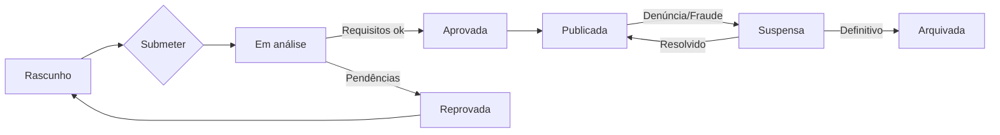

### 4.2 Disponibilidade e calendário

- **RB-10** Disponibilidade é por **acomodação × data**; uma reserva consome estoque nas noites do período.
- **RB-11** Bloqueio de datas: manual (proprietário/recepção) ou automático (reserva confirmada, manutenção).
- **RB-12** Regras configuráveis: **mínimo de noites**, antecedência mínima/máxima, janela de check-in/out, temporadas com tarifa diferenciada.
- **RB-13** Overbooking é **proibido** por padrão; o sistema recusa reservas sem estoque.
- **RB-14** Alteração de tarifa não afeta reservas já confirmadas (preço é "congelado" no ato).

### 4.3 Ciclo de vida da reserva

- **RB-20** Estados: `iniciada → aguardando_pagamento → confirmada → em_estadia → concluída`; ramos: `cancelada`, `no_show`, `expirada`.
- **RB-21** Uma reserva **iniciada** segura o estoque por um TTL curto (ex.: 15 min); expira se o pagamento não for concluído.
- **RB-22** **Confirmada** somente após pagamento aprovado (ou pré-autorização válida).
- **RB-23** Preço total = (tarifa × noites) + taxas − descontos; exibido antes do pagamento (sem surpresas).
- **RB-24** Modificação de datas gera recálculo e é sujeita à disponibilidade e à política de tarifas.

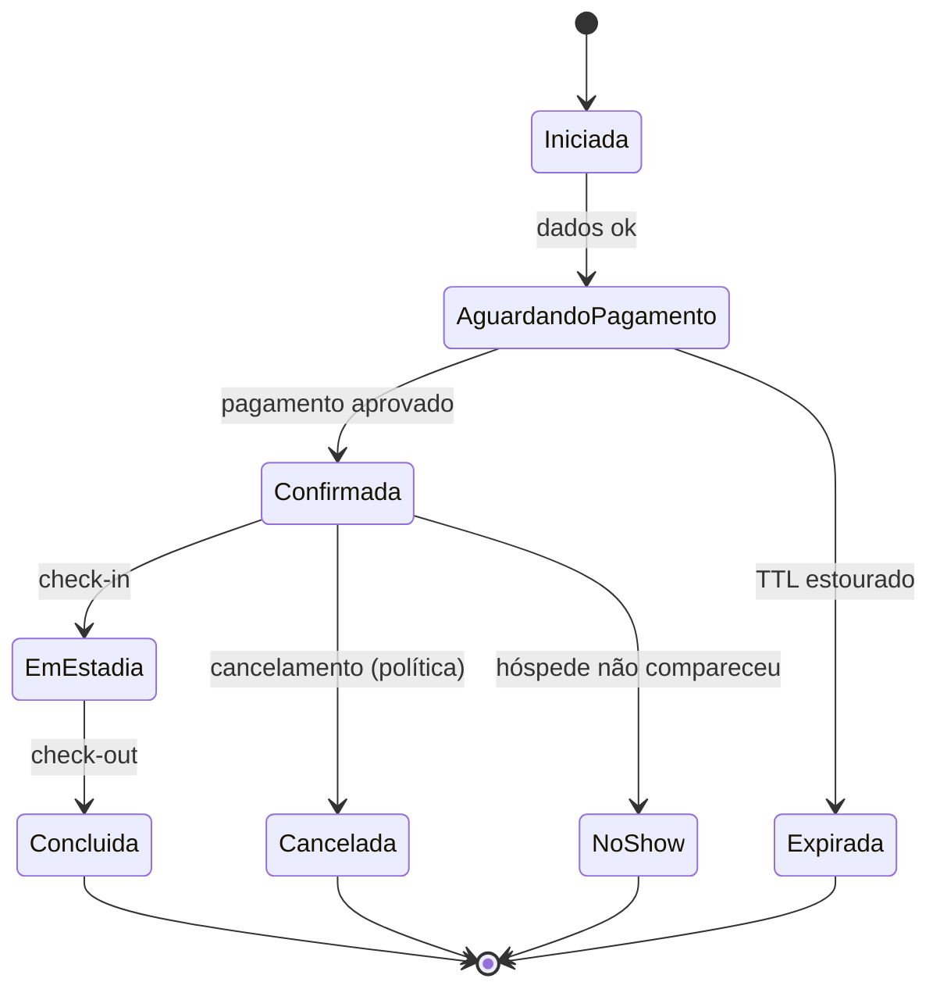

### 4.4 Cancelamento e reembolso

- **RB-30** Cada pousada escolhe uma **política de cancelamento** (Flexível, Moderada, Rígida).
- **RB-31** O reembolso é calculado pela política vigente **no momento da reserva** e pela antecedência do cancelamento.

| Política | Reembolso total se… | Reembolso parcial | Sem reembolso |
|---|---|---|---|
| Flexível | cancelar até 24h antes do check-in | — | após o check-in |
| Moderada | cancelar até 5 dias antes | 50% até 48h antes | < 48h |
| Rígida | cancelar até 14 dias antes | 50% até 7 dias | < 7 dias |

- **RB-32** Taxas de serviço podem ser não reembolsáveis (informado no checkout).
- **RB-33** Cancelamento pela **pousada** gera reembolso integral ao hóspede + penalidade/realocação assistida.
- **RB-34** Reembolsos seguem o método de pagamento original; prazo comunicado ao hóspede.

### 4.5 Check-in e check-out

- **RB-40** Check-in disponível a partir da janela definida; instruções liberadas conforme política (ex.: após pagamento e D-1).
- **RB-41** Check-out registra a conclusão e **habilita a avaliação**.
- **RB-42** No-show é registrado após a janela; aplica política de cancelamento correspondente.

### 4.6 Avaliações, denúncias e moderação

- **RB-50** Só **hóspedes com estadia concluída** podem avaliar (review verificado).
- **RB-51** Janela para avaliar: até 14 dias após o check-out.
- **RB-52** A pousada pode **responder** publicamente uma vez por avaliação.
- **RB-53** Avaliações e conteúdos podem ser **denunciados**; entram na fila de moderação.
- **RB-54** Moderação remove conteúdo que viole diretrizes (ofensivo, falso, fora de contexto), com registro em auditoria.
- **RB-55** A IA faz **triagem** de moderação; remoção/punição definitiva exige revisão humana.

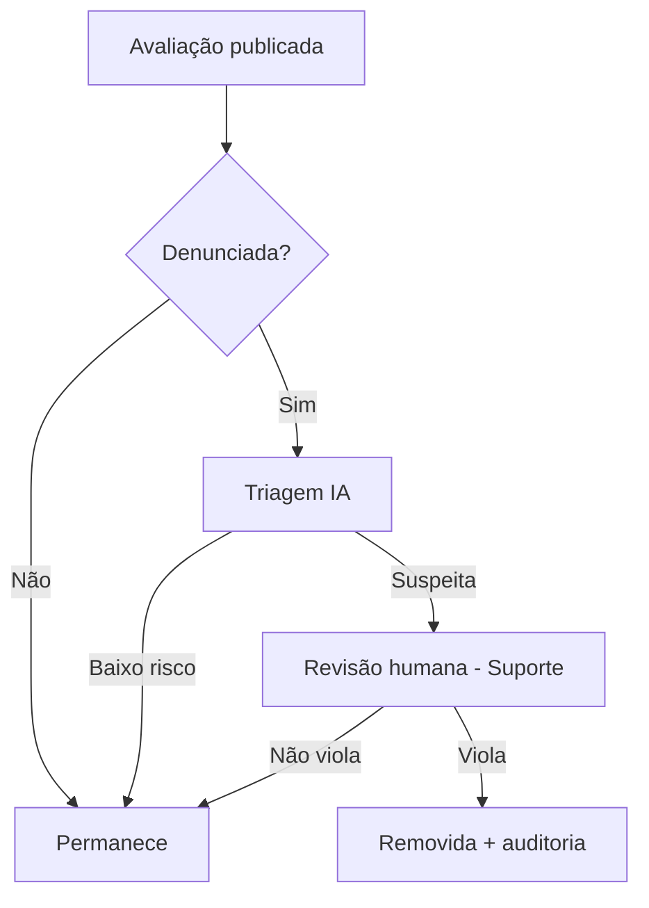

### 4.7 Suporte e disputas

- **RB-60** Toda disputa abre um **ticket** com visão 360º da reserva.
- **RB-61** Reembolsos de cortesia acima de um limite exigem aprovação de nível superior.
- **RB-62** Ações sensíveis do suporte (ver dados, reembolsar, suspender) são **logadas** com justificativa (RB de auditoria).

---

## 5. Fluxos do Sistema

### 5.1 Jornada macro (fim a fim)

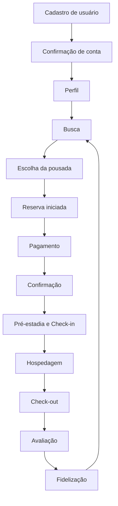

### 5.2 Descoberta e busca

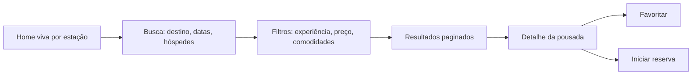

### 5.3 Reserva e pagamento (sequência)

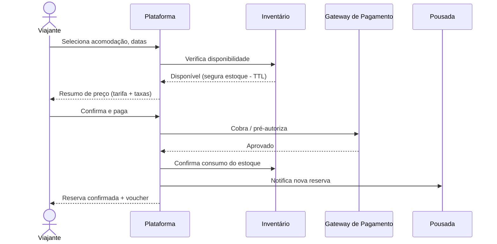

### 5.4 Onboarding e aprovação de anfitrião

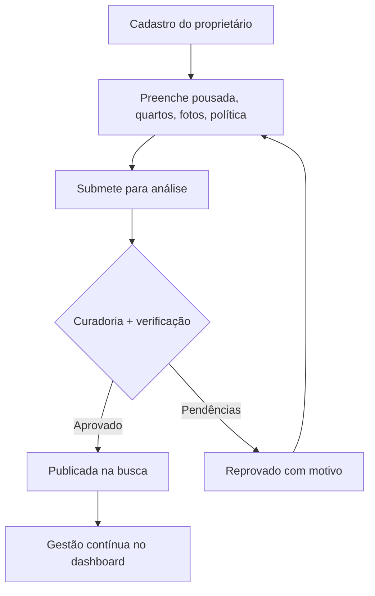

### 5.5 Ciclo de estadia (check-in → avaliação)

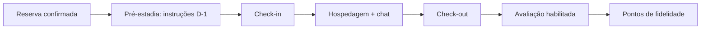

### 5.6 Suporte / disputa

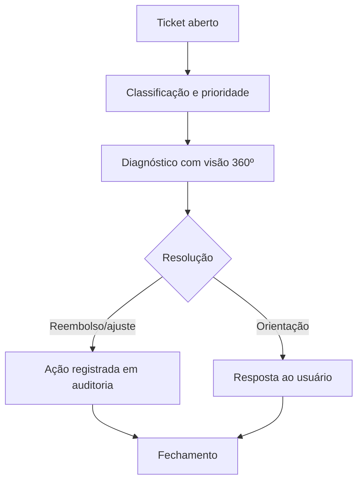

---

## 6. Entidades do Negócio

Modelo **conceitual** (sem BD). Descreve entidades, principais atributos e
relacionamentos. Alinha-se aos tipos de domínio em `types/` quando implementado.

### 6.1 Diagrama de relacionamento (conceitual)

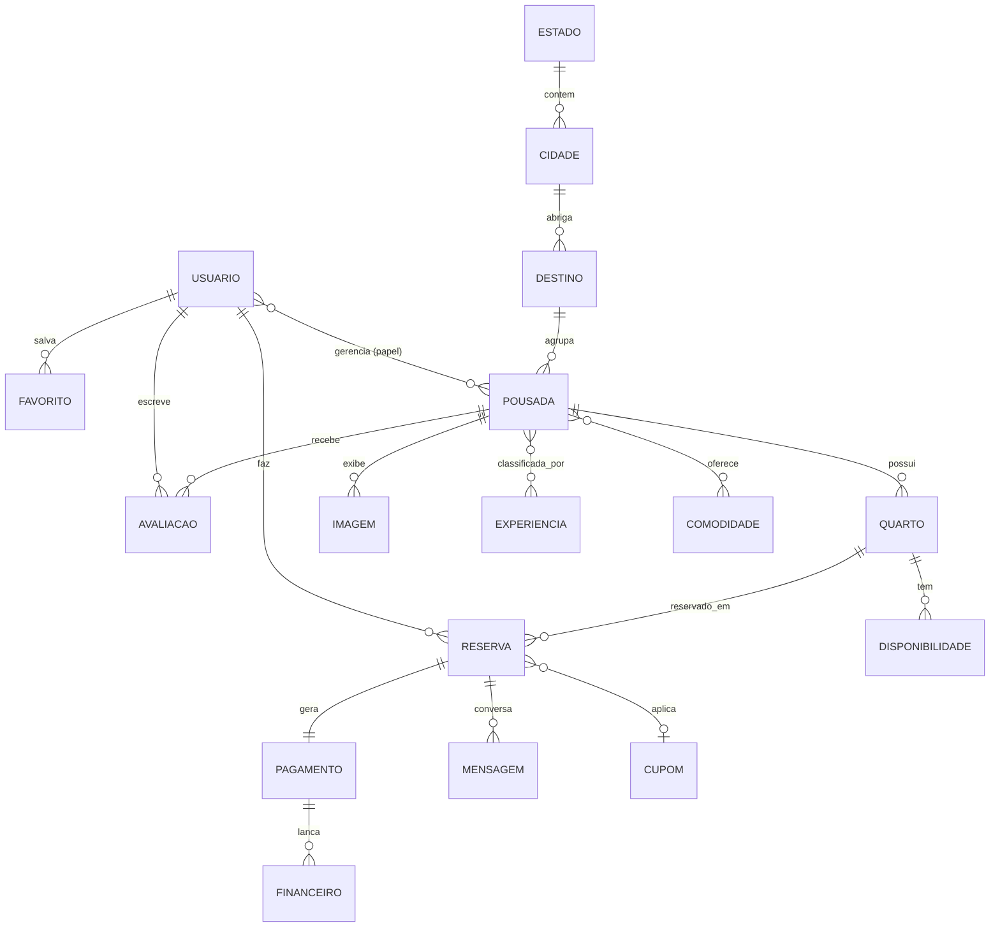

### 6.2 Catálogo de entidades

| Entidade | Descrição | Principais atributos | Relaciona-se com |
|---|---|---|---|
| **Usuário** | Qualquer conta (viajante ou membro de equipe) | id, nome, e-mail, papéis, preferências, status | Reserva, Avaliação, Favorito, Pousada |
| **Perfil** | Extensão do usuário (viajante/anfitrião) | bio, documento, contato, payout (anfitrião) | Usuário |
| **Estado** | UF do Brasil | sigla, nome | Cidade |
| **Cidade** | Município | nome, estado, geo | Estado, Destino |
| **Destino** | Cluster turístico curado | slug, nome, imagem, estação, rating | Cidade, Pousada |
| **Região** | Agrupamento macro (SE, S, NE…) | código, nome | Estado |
| **Experiência** | Taxonomia de estilo | slug, nome, ícone, descrição | Pousada |
| **Comodidade** | Recurso oferecido | nome, categoria | Pousada, Quarto |
| **Pousada** | Estabelecimento | slug, nome, cidade/estado, descrição, status, política, rating | Quarto, Imagem, Avaliação, Destino |
| **Quarto/Acomodação** | Unidade vendável | nome, capacidade, tamanho, tarifa base | Pousada, Disponibilidade, Reserva |
| **Categoria** | Tipo de acomodação | nome, descrição | Quarto |
| **Imagem / Vídeo** | Mídia da pousada/quarto | url, alt, ordem, tipo | Pousada, Quarto |
| **Disponibilidade** | Estoque por data | data, quarto, status, tarifa do dia | Quarto |
| **Reserva** | Booking | código, período, hóspedes, valores, status | Usuário, Quarto, Pagamento |
| **Pagamento** | Transação financeira | valor, método, status, split, reembolsos | Reserva, Financeiro |
| **Cupom** | Desconto | código, tipo, valor, regras, validade | Reserva |
| **Avaliação** | Review verificado | nota, texto, resposta, status | Usuário, Pousada, Reserva |
| **Mensagem** | Comunicação | remetente, conteúdo, timestamp, canal | Reserva, Usuário |
| **Notificação** | Aviso multicanal | tipo, canal, status de leitura | Usuário |
| **Evento** | Log de negócio/auditoria | ator, ação, alvo, timestamp, metadados | Usuário |
| **Financeiro** | Lançamento/repasse | tipo, valor, competência, status | Pagamento, Pousada |
| **Relatório** | Agregação analítica | escopo, período, métricas | Pousada, Plataforma |

---

## 7. Matriz de Permissões

Legenda: **✓** permitido · **○** limitado/condicional · **—** negado · **A**
requer aprovação · **L** ação logada em auditoria.
Papéis: VIS=Visitante · VJ=Viajante/Hóspede · PROP=Proprietário · ADM=Admin
Pousada · REC=Recepcionista · FIN=Financeiro Pousada · SUP=Suporte · COM=Comercial
· MKT=Marketing · MST=Admin Master · IA=Sistema IA.

| Ação | VIS | VJ | PROP | ADM | REC | FIN | SUP | COM | MKT | MST | IA |
|---|:--:|:--:|:--:|:--:|:--:|:--:|:--:|:--:|:--:|:--:|:--:|
| Visualizar catálogo público | ✓ | ✓ | ✓ | ✓ | ✓ | ✓ | ✓ | ✓ | ✓ | ✓ | ✓ |
| Buscar / filtrar | ✓ | ✓ | ✓ | ✓ | ✓ | ✓ | ✓ | ✓ | ✓ | ✓ | ✓ |
| Favoritar | — | ✓ | ✓ | ○ | — | — | — | — | — | ✓ | — |
| Criar reserva | — | ✓ | ○ | ○ | ○ | — | ○ | — | — | ✓ | — |
| Cancelar reserva | — | ○ | ○ | ○ | ○ | — | ✓L | — | — | ✓L | — |
| Pagar | — | ✓ | — | — | — | — | — | — | — | — | — |
| Receber pagamentos (payout) | — | — | ✓ | — | — | ○ | — | — | — | ✓L | — |
| Criar/editar pousada | — | — | ✓ | ✓ | — | — | — | ○ | — | ✓ | — |
| Excluir pousada | — | — | ✓ | — | — | — | — | — | — | ✓L | — |
| Aprovar pousada | — | — | — | — | — | — | — | ✓L | — | ✓L | ○ (triagem) |
| Gerenciar quartos | — | — | ✓ | ✓ | ○ | — | — | — | — | ✓ | — |
| Gerenciar calendário/bloqueios | — | — | ✓ | ✓ | ○ | — | — | — | — | ✓ | ○ (sugestão) |
| Definir tarifas/promoções | — | — | ✓ | ✓ | — | — | — | — | ○ | ✓ | ○ (sugestão) |
| Criar cupom de plataforma | — | — | — | — | — | — | — | — | ✓ | ✓ | — |
| Responder avaliações | — | — | ✓ | ✓ | — | — | ○ | — | — | ✓ | ○ (rascunho) |
| Moderar conteúdo | — | — | — | — | — | — | ✓L | — | ○ | ✓L | ○ (triagem) |
| Realizar check-in/out | — | ○ (self) | ✓ | ✓ | ✓ | — | — | — | — | ✓ | — |
| Ver financeiro da pousada | — | — | ✓ | ○ | — | ✓ | ○ | — | — | ✓ | — |
| Ver relatórios globais | — | — | — | — | — | — | ○ | ○ | ○ | ✓ | — |
| Administrar usuários/papéis | — | — | ○ (equipe) | — | — | — | — | — | — | ✓L | — |
| Configurar plataforma / flags | — | — | — | — | — | — | — | — | — | ✓L | — |
| Ver trilha de auditoria | — | — | ○ (própria) | — | — | — | ✓ | — | — | ✓ | — |

> **Princípio:** menor privilégio por padrão; ações irreversíveis ou sensíveis
> sempre logadas (**L**) e, quando críticas, sob aprovação (**A**). A IA nunca
> executa ações irreversíveis sozinha.

---

## 8. Jornadas dos Usuários

Jornadas detalhadas em **fases → objetivo do usuário → ações → o que a Rota
entrega → métrica-chave**.

### 8.1 Visitante — de curioso a cadastrado

| Fase | Objetivo | Ações | Entrega da Rota | Métrica |
|---|---|---|---|---|
| Descoberta | Entender o valor | Chega via SEO/mídia, vê a home viva | Curadoria por estação, estética forte | Bounce rate |
| Exploração | Encontrar algo que encante | Busca, filtra por experiência | Resultados relevantes, fotos ricas | Buscas/sessão |
| Consideração | Confiar | Lê avaliações, vê detalhes | Prova social, transparência de preço | Tempo no detalhe |
| Conversão do cadastro | Guardar/reservar | Tenta favoritar/reservar → cria conta | Cadastro rápido, sem fricção | Signup rate |

**Momento crítico:** o "muro" de cadastro deve aparecer só quando há intenção
(favoritar/reservar), nunca antes — reduz atrito e maximiza descoberta.

### 8.2 Viajante → Hóspede — de intenção a fidelização

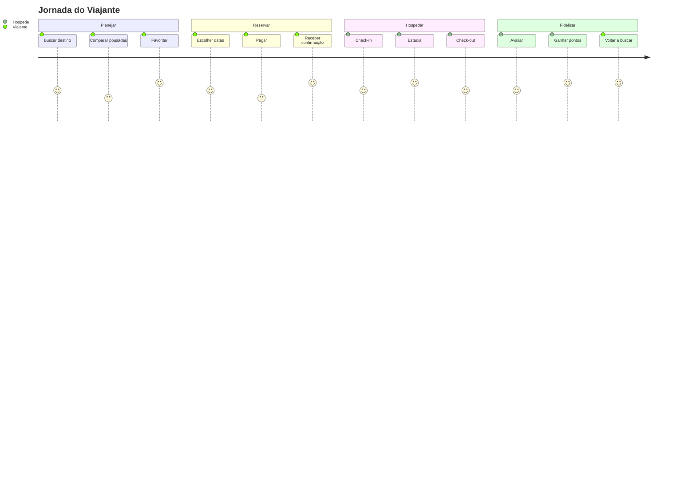

**Momentos de verdade:** clareza de preço no checkout, confirmação imediata,
instruções de check-in no D-1, suporte responsivo, pedido de avaliação no timing certo.

### 8.3 Proprietário — de cadastro a receita recorrente

| Fase | Objetivo | Ações | Entrega da Rota | Métrica |
|---|---|---|---|---|
| Aquisição | Descobrir a Rota | Indicação/comercial/mídia | Proposta de valor clara | Leads |
| Onboarding | Publicar rápido | Cadastra pousada, quartos, fotos | Onboarding assistido + IA de conteúdo | Tempo até publicar |
| Ativação | Primeira reserva | Ajusta tarifas e calendário | Sugestões de precificação (IA) | Time-to-first-booking |
| Operação | Gerir o dia a dia | Reservas, mensagens, check-in | Dashboard + notificações | Ocupação |
| Crescimento | Aumentar receita | Promoções, destaques, campanhas | Copiloto de receita/marketing | RevPAR, GMV |
| Retenção | Continuar na Rota | Vê valor financeiro | Relatórios, payout confiável | Churn de anfitrião |

### 8.4 Administrador Master — governança

Fases: **monitorar** (KPIs da rede) → **decidir** (curadoria, políticas, flags) →
**intervir** (aprovações, suspensões, exceções) → **auditar** (trilha completa).
Métricas: GMV, take rate, pousadas ativas, NPS de ambos os lados, fraude.

### 8.5 Suporte — resolver com confiança

Fases: **receber** (ticket) → **entender** (visão 360º) → **agir** (mediar,
reembolsar dentro da política) → **registrar** (auditoria) → **aprender**
(feedback ao produto). Métricas: TMR (tempo médio de resolução), CSAT, reabertura.

### 8.6 Financeiro — conciliar e repassar

Fases: **conciliar** (pagamentos × reservas) → **repassar** (payouts) →
**faturar** (comissões/assinaturas) → **reportar** (liderança/fiscal). Métricas:
tempo de fechamento, precisão de repasse, inadimplência.

---

## 9. Monetização e modelo de pagamento

> **Decisão de modelo (v1.1, substitui o anterior de comissão/marketplace):** a
> Rota é uma **empresa de software (SaaS)**, não uma processadora de pagamentos.
> A receita vem da **assinatura** que as pousadas pagam pelo sistema de gestão e
> automação. **O pagamento do hóspede vai direto para a pousada** — a Rota não
> retém, não faz split, não repassa, e portanto **não é instituição de pagamento**
> (evita regulação de meios de pagamento, KYC de marketplace, custódia e risco de
> chargeback).

### 9.1 Fluxo financeiro

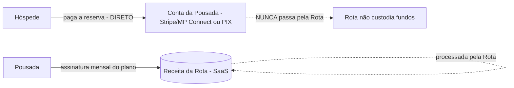

- **Hóspede → Pousada (reserva):** processado pela **conta própria da pousada**
  (Stripe/Mercado Pago Connect ou chave PIX da pousada). O dinheiro é da pousada.
- **Pousada → Rota (assinatura):** recorrência processada **pela Rota** — é a
  receita da empresa.

### 9.2 Fontes de receita

| Fonte | Como funciona | Paga | Prioridade |
|---|---|---|---|
| **Assinatura por plano (SaaS)** | recorrência por pousada; tiers com limites/recursos de gestão e automação | Pousada → Rota | **Principal** |
| **Add-ons / Premium** | IA avançada, multipropriedade, integrações fiscais, canais/OTA | Pousada → Rota | Futuro |
| **Destaques no marketplace** | impulsionar visibilidade da pousada na busca/home | Pousada → Rota | Futuro |
| **Experiências / afiliados** | comissão de parceiros (passeios, seguro, transfer) — nunca da reserva da pousada | Parceiro | Enterprise |

> **Estratégia:** a automação operacional (§9.3) cria o valor que sustenta a
> assinatura. Sem take rate sobre reserva, o alinhamento com a pousada é total —
> a Rota ganha quando a pousada tem sucesso operacional, não uma fatia de cada venda.

### 9.3 Escopo: sistema de gestão completo da pousada (PMS + ERP)

A "grande sacada" é ser o **sistema operacional único** que substitui o
caderno + planilha + WhatsApp + várias ferramentas avulsas. Módulos de gestão:

| Domínio | Inclui |
|---|---|
| **Hospedagem (PMS)** | reservas, calendário/disponibilidade, bloqueio de datas, check-in/out, quartos/tarifas |
| **Financeiro (ERP)** | contas a receber/pagar, fluxo de caixa, faturamento, conciliação de pagamentos (das contas da pousada), relatórios, emissão fiscal (NF) |
| **RH / Funcionários** | cadastro de equipe, papéis/permissões (RBAC), escalas/turnos, controle de ponto, tarefas |
| **Hóspedes / CRM** | histórico, preferências, mensageria (WhatsApp/e-mail), pós-estadia |
| **Comercial / Marketing** | promoções, campanhas, canais/OTA, destaque no marketplace |
| **Gestão / BI** | dashboards, metas, relatórios executivos |
| **Automação / IA (transversal)** | precificação, marketing, concierge, copiloto — sobre todos os módulos |

> O marketplace (demanda) e o sistema de gestão (oferta) se retroalimentam: a
> pousada adere pela gestão e ganha distribuição; o hóspede encontra e reserva; a
> operação inteira roda num só lugar.

---

## 10. Integrações Futuras

Cada integração entra atrás de uma **abstração** na camada `services/` — trocável
sem impacto na UI.

| Categoria | Integração | Uso | Fase |
|---|---|---|---|
| Pagamentos | **Stripe** | Cobrança internacional, split, payout | V2 |
| Pagamentos | **Mercado Pago** | Meios locais, carteira | V2 |
| Pagamentos | **PIX** | Pagamento instantâneo BR | V2 |
| Mapas | **Google Maps / Places** | Geolocalização, autocomplete, mapa | V2 |
| Comunicação | **WhatsApp Business** | Notificações e atendimento | V2 |
| Social | **Instagram / Facebook** | Login social, marketing, catálogo | V3 |
| IA | **OpenAI / LLM** | Concierge, copiloto, moderação | V3 |
| Dados/Backend | **Supabase** (ou Postgres gerenciado) | Persistência, auth, storage | V2 |
| Infra | **Vercel** | Hosting, edge, ISR | MVP |
| Infra/CDN | **Cloudflare** | CDN, WAF, imagens | V2 |
| Analytics | **Vercel/GA/Umami** | Produto e marketing | MVP→ |
| Backoffice | **ERP** | Financeiro e operações | Enterprise |
| Fiscal | **Emissor de NF-e/NFS-e** | Obrigações fiscais | Enterprise |

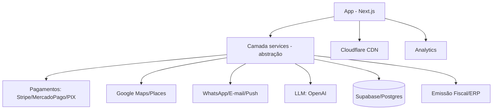

---

## 11. Escalabilidade

Meta: **100.000 pousadas · 10 milhões de usuários · 100 milhões de reservas**,
sem reestruturação. A base técnica (ver `Architecture.md`) já contempla os
contratos; abaixo, as decisões de negócio que sustentam a escala.

| Dimensão | Estratégia |
|---|---|
| **Catálogo (100k pousadas)** | SSG + ISR por pousada; geração sob demanda + cache; sem build proibitivo |
| **Busca em escala** | Índice dedicado (Postgres FTS → Meilisearch/Typesense/Algolia); busca facetada por experiência/região |
| **Leitura massiva (10M usuários)** | Server Components + CDN + cache por request; estado de cliente mínimo |
| **Escrita (100M reservas)** | Idempotência no checkout, filas para efeitos colaterais (e-mail, payout), particionamento por período |
| **Disponibilidade** | Modelo estoque por data com reservas idempotentes e locks curtos; sem overbooking |
| **Pagamentos** | Split e payout assíncronos, reconciliação por eventos |
| **Multi-tenant** | Isolamento por pousada/anfitrião; RBAC; dados de uma pousada nunca vazam para outra |
| **Internacional** | i18n e multi-moeda previstos como camada, não retrofit |
| **Observabilidade** | Métricas de negócio + técnicas, auditoria de ações sensíveis |
| **Custo** | Cache agressivo, imagens em CDN, edge; custo marginal por página tende a zero |

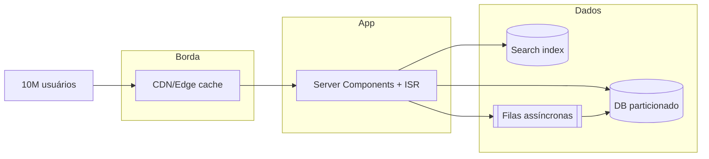

---

## 12. Roadmap do Produto

Fases orientadas a resultado. Datas relativas ao início (T0 = lançamento do MVP).

| Fase | Foco | Escopo principal | Sucesso |
|---|---|---|---|
| **MVP** | Descoberta + oferta curada | Catálogo, busca, detalhe, favoritos, dashboards (visão), onboarding de anfitrião, SEO | Oferta curada crescendo, tráfego qualificado |
| **V2** | Transação | Reservas, pagamentos (Stripe/MP/PIX), avaliações, chat, notificações, cupons, relatórios | Primeira reserva ponta a ponta; GMV inicial |
| **V3** | Inteligência + retenção | IA concierge, copiloto de receita, fidelidade, blog, afiliados, marketing avançado | Retenção de ambos os lados; take rate saudável |
| **Enterprise** | Ecossistema + backoffice | Marketplace de experiências, seguro/transfer, ERP, emissão fiscal, SSO/RBAC avançado | Diversificação de receita; grandes contas |
| **Internacional** | Expansão | Multi-idioma, multi-moeda, compliance regional, marca global | Operação fora do Brasil |

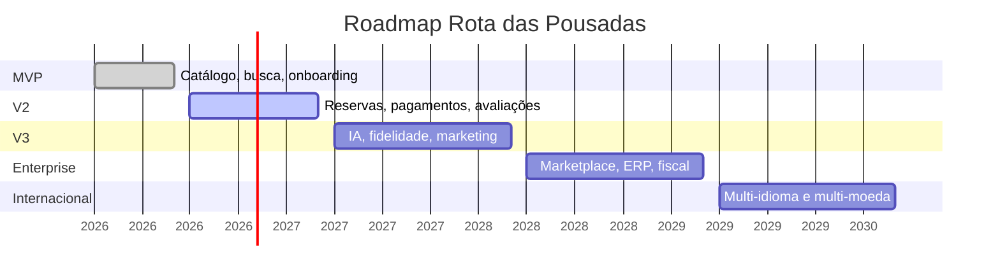

---

## 13. Princípios do Produto

Princípios oficiais — critérios de decisão quando houver dúvida ou conflito.

1. **Experiência do usuário acima de tudo.** Se atrapalha o usuário, não vai.
2. **Performance é feature.** Nunca sacrificar velocidade; busca e páginas
   respondem rápido (metas explícitas de latência).
3. **Mobile-first.** Toda funcionalidade nasce pensando no celular.
4. **Acessível por padrão.** Toda tela atende critérios de acessibilidade (WCAG AA).
5. **Curadoria com alma.** Qualidade e identidade acima de volume bruto.
6. **Confiança é o produto.** Transparência de preço, avaliações verificadas,
   suporte humano e pagamento protegido.
7. **Equilíbrio dos dois lados.** Decisões consideram viajante _e_ anfitrião.
8. **IA amplia, humano decide.** IA sugere e acelera; ações sensíveis têm humano no circuito.
9. **Privacidade e menor privilégio.** Coleta mínima; acesso mínimo; auditoria de ações sensíveis.
10. **Escalável desde o design.** Nenhuma decisão que exija reescrita para crescer.
11. **Documentação é parte da entrega.** Nenhuma funcionalidade sem documentação;
    nenhum código sem contexto (ver `AI_RULES.md`).
12. **Consistência via Design System.** Uma só linguagem visual e de componentes.

---

## 14. Glossário

| Termo | Definição |
|---|---|
| **GMV** | _Gross Merchandise Value_ — valor total transacionado em reservas. |
| **Take rate** | Percentual do GMV que a plataforma retém como receita. |
| **RevPAR** | Receita por acomodação disponível — eficiência de ocupação × diária. |
| **OTA** | _Online Travel Agency_ (Booking, Expedia…) — canal de distribuição. |
| **Payout** | Repasse financeiro à pousada após a reserva. |
| **Split** | Divisão do pagamento entre plataforma e pousada. |
| **ISR** | _Incremental Static Regeneration_ — geração estática incremental (Next.js). |
| **RBAC** | Controle de acesso baseado em papéis. |
| **No-show** | Hóspede que não comparece na data reservada. |
| **Network effect** | Mais oferta atrai mais demanda e vice-versa. |
| **TTL** | _Time to live_ — janela em que o estoque fica reservado durante o checkout. |
| **NPS / CSAT** | Métricas de satisfação (recomendação / atendimento). |

---

> _Documento vivo._ Alterações relevantes devem ser versionadas e comunicadas ao
> time de produto. Esta é a **referência-mãe de negócio** da Rota das Pousadas.

