# Architecture.md — Arquitetura Técnica Oficial

> **Referência técnica definitiva** da plataforma Rota das Pousadas. Leitura
> obrigatória para todo desenvolvedor humano e IA (Claude, Codex, ChatGPT).
> Este documento define _como_ construímos; o _quê_/_porquê_ do negócio está em
> [`04_BUSINESS_ARCHITECTURE.md`](04_BUSINESS_ARCHITECTURE.md). Não altera regras
> de negócio. Complementa `DesignSystem.md`, `DesignFoundations.md`,
> `FolderStructure.md`, `CodingStandards.md` e `AI_RULES.md`.

| Campo | Valor |
|---|---|
| Versão | 1.0 |
| Status | Aprovado — referência técnica definitiva |
| Metas de escala | 100.000 pousadas · 10M usuários · 100M+ reservas |
| Perfil de leitor | Engenharia (humana e IA), Arquitetura, Tech Leads |

### Sumário

1. [Visão Geral da Arquitetura](#1-visão-geral-da-arquitetura) ·
2. [Stack Tecnológica](#2-stack-tecnológica) ·
3. [Organização das Pastas](#3-organização-das-pastas) ·
4. [Arquitetura Feature First](#4-arquitetura-feature-first) ·
5. [Camadas da Aplicação](#5-camadas-da-aplicação) ·
6. [Fluxo de Dados](#6-fluxo-de-dados) ·
7. [Estratégia de Cache](#7-estratégia-de-cache) ·
8. [Estratégia de Performance](#8-estratégia-de-performance) ·
9. [SEO](#9-seo) ·
10. [Estratégia Mobile](#10-estratégia-mobile) ·
11. [Segurança](#11-segurança) ·
12. [Banco de Dados](#12-banco-de-dados) ·
13. [Integrações](#13-integrações) ·
14. [Observabilidade](#14-observabilidade) ·
15. [Estratégia de IA](#15-estratégia-de-ia) ·
16. [Multi-Tenant](#16-multi-tenant) ·
17. [Escalabilidade](#17-escalabilidade) ·
18. [Convenções](#18-convenções) ·
19. [Fluxos Técnicos](#19-fluxos-técnicos) ·
20. [Princípios da Engenharia](#20-princípios-da-engenharia)

---

## 1. Visão Geral da Arquitetura

A Rota das Pousadas é uma aplicação **Next.js (App Router) full-stack** com
renderização _server-first_, camadas estritamente separadas e persistência em
**Supabase (PostgreSQL)**. A UI nunca fala com o banco diretamente: todo acesso
a dados desce por Server Components/Actions → Services → Repositories.

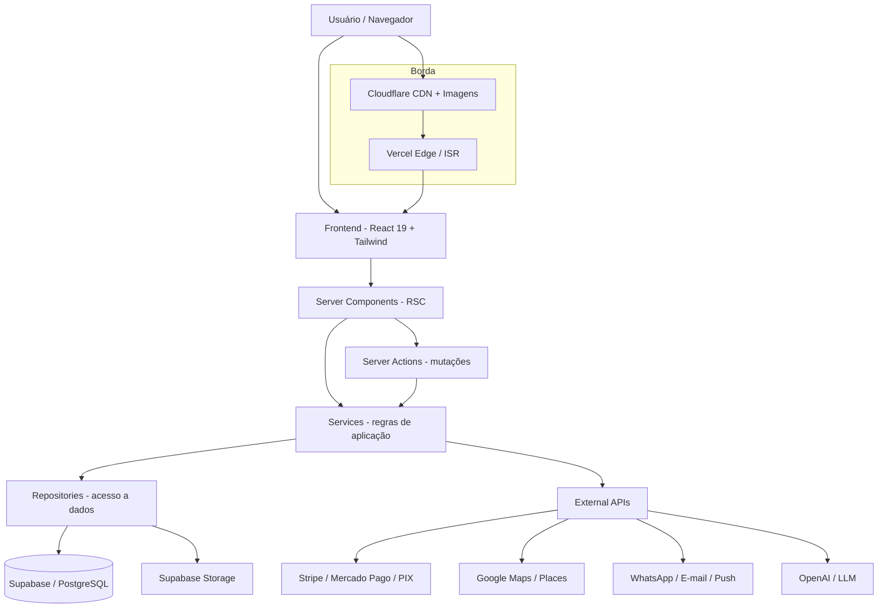

**Camadas (resumo):** `Frontend → Server Components → Actions → Services →
Repository → Supabase → Storage → External APIs`. Cada seta é um contrato
tipado; cada camada só conhece a imediatamente abaixo.

**Decisões-chave**

| Decisão | Motivo |
|---|---|
| Server-first (RSC) | Menos JS no cliente, dados perto da fonte, melhor TTFB/SEO |
| Camadas isoladas | Testabilidade, troca de fornecedor sem reescrever UI |
| Supabase | Postgres gerenciado + Auth + Storage + RLS num só provedor |
| Vercel + Cloudflare | ISR/edge + CDN/imagens/WAF de nível global |
| Feature First | Módulos isoláveis → escala de time e de produto |

---

## 2. Stack Tecnológica

Stack **oficial**. Novas dependências exigem justificativa e alinhamento com estas escolhas.

### Frontend

| Tecnologia | Versão-alvo | Papel |
|---|---|---|
| **Next.js** | 16 (App Router) | Framework full-stack, RSC, ISR, Server Actions |
| **React** | 19 | UI, Server/Client Components |
| **TypeScript** | 5.x **strict** | Tipagem estática rigorosa |
| **Tailwind CSS** | 4 | Estilização via tokens do Design System |
| **Motion** | 12 | Animações (tokens de motion) |
| **React Hook Form** | 7 | Formulários performáticos (uncontrolled) |
| **Zod** | 3 | Validação de schema (client + server) |

### Backend / Dados / Infra

| Camada | Tecnologia | Papel |
|---|---|---|
| **Backend** | Supabase | Auth, RLS, funções, realtime |
| **Banco** | PostgreSQL (Supabase) | Persistência relacional |
| **Storage** | Supabase Storage | Mídia (fotos/vídeos de pousadas) |
| **Deploy** | Vercel | Hosting, edge, ISR, Server Actions |
| **Imagens/CDN** | Cloudflare | CDN, cache de imagens, WAF |
| **Monitoramento** | Sentry | Erros, performance, tracing |
| **Analytics** | Vercel Analytics | Web vitals, produto |

> **Estado atual vs. alvo:** o protótipo já usa Next 16 / React 19 / TS strict /
> Tailwind 4 / Motion. Supabase, RHF, Zod, Sentry e Cloudflare entram nas fases
> V2+ (ver Roadmap de negócio) atrás das camadas `services`/`repositories` já
> previstas — adoção sem reescrita.

---

## 3. Organização das Pastas

```
rota-das-pousadas/
├── app/                    # Rotas (App Router): pages, layouts, loading/error/not-found, SEO
├── components/
│   ├── ui/                 # Design System (agnóstico de domínio)
│   ├── layout/             # Header, Footer, Shell, Container
│   ├── home/               # Seções da landing
│   ├── pousada/            # Blocos da página de pousada
│   ├── dashboard/          # Shell + charts dos painéis
│   └── seo/                # JSON-LD e afins
├── features/               # Módulos de domínio (Feature First)
├── services/               # Regras de aplicação (server-only)
├── repositories/           # Acesso a dados (única camada que fala com o BD)
├── server/                 # Helpers RSC + cache por request
├── actions/                # Server Actions (mutações)
├── types/                  # Modelo de domínio + contratos de transporte
├── hooks/                  # Hooks reutilizáveis (client)
├── lib/                    # Utils, design-tokens, seo, config
├── styles/                 # Tokens CSS + tipografia
├── emails/                 # Templates transacionais
├── public/                 # Estáticos, ícones, favicons
├── supabase/               # Migrations, policies (RLS), seeds, types gerados
└── docs/                   # Documentação (esta pasta)
```

### Responsabilidade de cada pasta

| Pasta | Responsabilidade | Regra |
|---|---|---|
| `app/` | Compor rotas; buscar dados via `server/`; renderizar | Sem regra de negócio pesada |
| `components/ui/` | Primitivos visuais reutilizáveis | Zero domínio; nada de fetch |
| `components/layout/` | Estruturas de página (header/footer/shell) | Composição de `ui/` |
| `components/{home,pousada,dashboard}/` | Blocos específicos de tela | Composição, sem acesso a BD |
| `features/` | Domínios isolados (ver §4) | Fronteira do módulo |
| `services/` | Regras de aplicação, orquestração | `server-only`; chama `repositories` |
| `repositories/` | Consultas/persistência | **Única** camada que acessa o BD |
| `server/` | Wrappers RSC + `cache()`/`revalidate` | Ponto de entrada de dados para RSC |
| `actions/` | Mutações (Server Actions) | Valida com Zod; retorna `ActionResult` |
| `types/` | Tipos de domínio e transporte | Fonte da verdade de tipos |
| `hooks/` | Lógica de client reutilizável | Client-only |
| `lib/` | Utilitários puros, tokens, SEO | Sem estado global mutável |
| `styles/` | Tokens de design (CSS) | Fonte de motion/spacing/etc. |
| `supabase/` | Migrations, RLS, seeds, types | Infra de dados versionada |

---

## 4. Arquitetura Feature First

Cada módulo de negócio é uma **feature autocontida**. Isso permite times
paralelos, deleção segura e crescimento sem acoplamento.

```
features/
├── busca/
├── pousadas/
├── reservas/
├── pagamentos/
├── avaliacoes/
├── usuarios/
├── dashboard/
├── marketing/
└── chat/
```

**Anatomia obrigatória de uma feature:**

```
features/reservas/
├── components/     # UI específica da feature (compõe components/ui)
├── hooks/          # hooks da feature (client)
├── actions/        # Server Actions da feature (mutações)
├── services/       # regras de aplicação da feature (server-only)
├── schemas/        # validação Zod (entrada/saída)
├── types/          # tipos internos da feature
└── index.ts        # barrel: superfície pública da feature
```

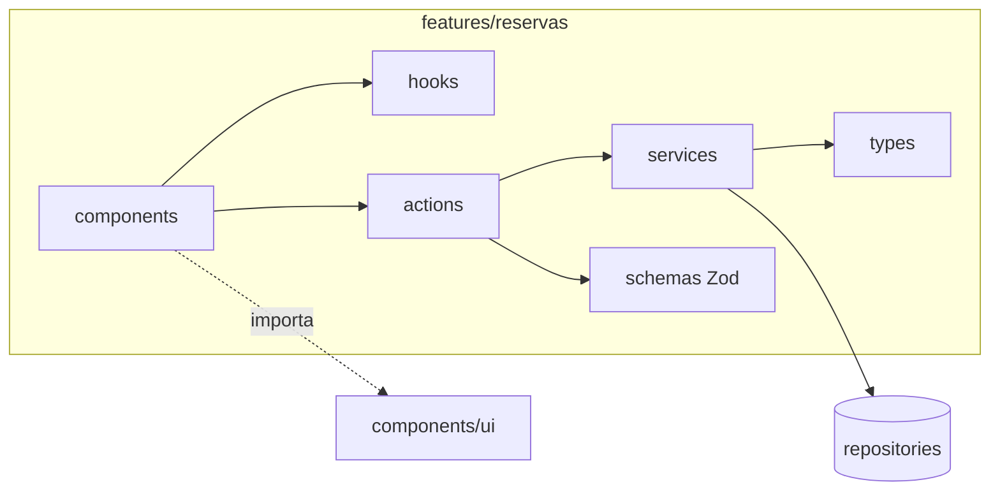

**Regras de fronteira**

| Regra | Descrição |
|---|---|
| Import só pelo barrel | Consumidores importam de `@/features/x`, nunca de arquivos internos |
| Sem imports cruzados profundos | Feature A não acessa `features/B/services/...`; usa o barrel público |
| UI compartilhada em `components/ui` | Nada de duplicar botões/cards dentro da feature |
| Dados via `services`→`repositories` | Componentes da feature nunca acessam BD |

---

## 5. Camadas da Aplicação

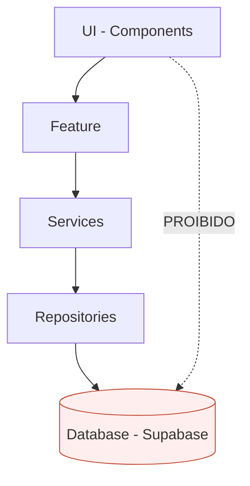

| Camada | Conhece | Não pode |
|---|---|---|
| **UI** | Feature/Design System | Acessar `repositories` ou BD |
| **Feature** | Services, UI | Consultar BD diretamente |
| **Services** | Repositories, outras Services | Renderizar UI, conhecer HTTP |
| **Repositories** | Cliente do BD/Storage | Conter regra de negócio |
| **Database** | — | — |

> **Regra de ouro:** _nenhuma tela acessa o banco diretamente._ O caminho é
> sempre `UI → Feature → Services → Repositories → Database`. Services concentram
> regra de aplicação; Repositories concentram consultas. Isso permite trocar
> Supabase por outro provedor mexendo só em `repositories`.

---

## 6. Fluxo de Dados

### Leitura (RSC)

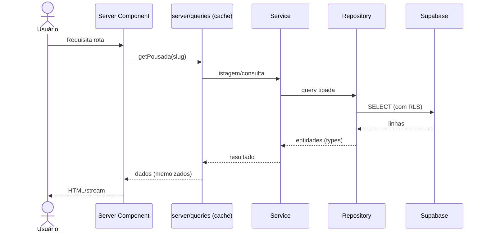

### Escrita (Server Action)

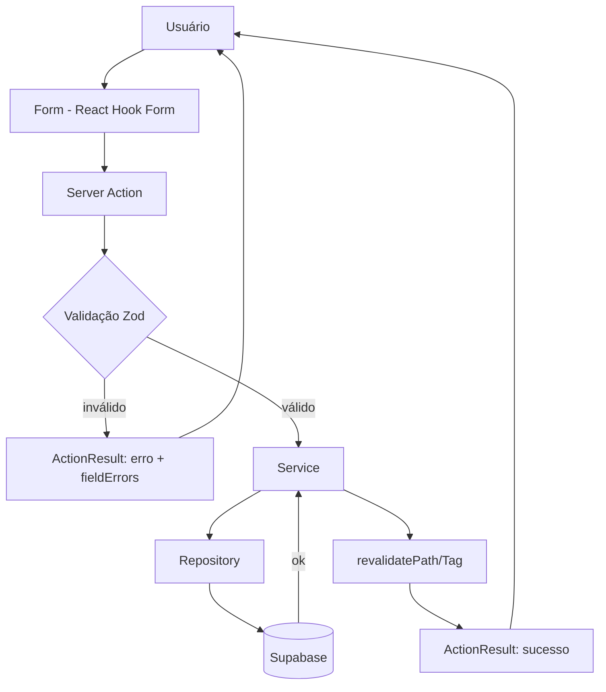

Todas as mutações retornam o envelope `ActionResult<T>` (`{ ok, data | error,
fieldErrors }`) — nunca lançam para a UI sem tratamento.

---

## 7. Estratégia de Cache

Cache em camadas, do mais próximo do usuário ao banco.

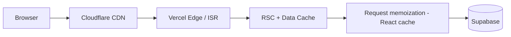

| Técnica | Uso na Rota | Notas |
|---|---|---|
| **SSG + ISR** | Páginas de pousada e destino | `generateStaticParams` + `revalidate`; 100k páginas sob demanda |
| **SSR** | Buscas com filtros dinâmicos, áreas logadas | Sempre fresco quando necessário |
| **RSC Data Cache** | Consultas de leitura | `fetch`/queries cacheados por tag |
| **Request memoization** | `react/cache` em `server/queries` | Evita consulta duplicada no mesmo render |
| **Edge cache** | Conteúdo público | Respostas próximas do usuário |
| **Cloudflare** | Imagens e estáticos | Cache global + transformação de imagem |
| **revalidatePath/Tag** | Após mutações | Invalidação cirúrgica pós-Action |
| **Streaming** | Páginas compostas | `<Suspense>` envia partes prontas antes |
| **Prefetch** | `<Link>` | Pré-carrega rotas prováveis |
| **Lazy loading** | Mídia e componentes pesados | `next/dynamic`, `loading="lazy"` |

**Regra:** conteúdo público → estático/ISR; conteúdo por usuário → dinâmico com
cache por request. Toda mutação invalida as tags afetadas.

---

## 8. Estratégia de Performance

Performance é _feature_ (ver §20). Metas: LCP < 2,5s, INP < 200ms, CLS < 0,1.

| Técnica | Padrão adotado |
|---|---|
| **Code splitting** | Automático por rota + fronteiras `dynamic()` |
| **Dynamic imports** | Componentes pesados/abaixo da dobra via `next/dynamic` (sem SSR quando client-only) |
| **Image optimization** | `next/image` sempre; `sizes`/`priority`/`fill`; AVIF/WebP; Cloudflare |
| **Virtualização** | Listas longas (resultados de busca, tabelas) virtualizadas |
| **Streaming** | `<Suspense>` + `loading.tsx` por rota |
| **Parallel routes** | Segmentos independentes carregados em paralelo (ex.: dashboard) |
| **Suspense** | Fronteiras de carregamento granulares |
| **Memoization** | `react/cache` no servidor; `useMemo`/`memo` só quando medido |
| **RSC-first** | Menos JS enviado; Client Components mínimos |
| **Bundle budget** | Orçamento por rota; `@next/bundle-analyzer` no CI |

> **Princípio:** medir antes de otimizar. Otimização especulativa (ex.: `memo`
> em tudo) é anti-padrão; usa-se com base em profiling e web vitals.

---

## 9. SEO

SEO técnico é primeira classe (a descoberta orgânica é canal-chave de demanda).

| Recurso | Implementação | Onde |
|---|---|---|
| **Metadata** | `metadata` global + `generateMetadata` por rota | `app/layout`, rotas dinâmicas |
| **OpenGraph** | OG por pousada/destino (título, descrição, imagem 1200×630) | `lib/seo` |
| **Twitter Cards** | `summary_large_image` | `lib/seo` |
| **JSON-LD** | `Organization` (site) + `LodgingBusiness` (pousada) | `components/seo/json-ld` |
| **Sitemap** | Dinâmico (rotas + pousadas) | `app/sitemap.ts` |
| **Robots** | Regras + host + sitemap; bloqueia `/dashboard` e `/admin` | `app/robots.ts` |
| **Canonical** | `alternates.canonical` por rota | `lib/seo` |
| **ISR** | Páginas indexáveis geradas estaticamente e revalidadas | rotas de conteúdo |
| **Schema.org** | Tipos `LodgingBusiness`, `AggregateRating`, `PostalAddress` | JSON-LD |
| **i18n (futuro)** | `alternates.languages` + hreflang | fase Internacional |

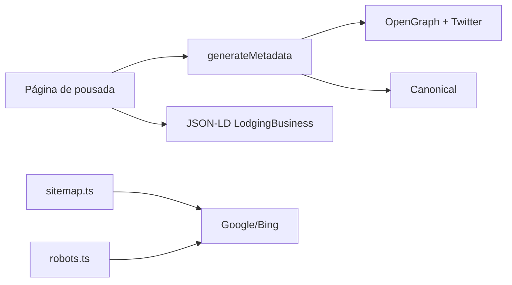

---

## 10. Estratégia Mobile

Mobile-first é regra (ver Princípios de Produto). A maior parte do tráfego de
viagem é móvel.

| Tema | Padrão |
|---|---|
| **Mobile First** | Estilos base para mobile; breakpoints `sm/md/lg` ampliam |
| **Touch targets** | Alvos ≥ 44×44px; espaçamento por tokens |
| **Bottom navigation** | Navegação primária ao alcance do polegar (áreas logadas) |
| **PWA** | `manifest.webmanifest`, ícones, tema; instalável |
| **Offline** | Service worker para shell + conteúdo consultado (fase PWA) |
| **Push** | Notificações (reservas, mensagens) via Web Push/WhatsApp |
| **Safe areas** | `env(safe-area-inset-*)` para notch/gestos |
| **Performance móvel** | Imagens responsivas, JS mínimo, `prefers-reduced-motion` |

---

## 11. Segurança

Segurança por padrão, defesa em profundidade e menor privilégio.

| Camada | Mecanismo | Detalhe |
|---|---|---|
| **Autorização (app)** | **RBAC** | Papéis da §2 do Business Architecture; checagem em Services/Actions |
| **Autorização (dados)** | **RLS** (Postgres) | Políticas por linha no Supabase; isolamento por tenant |
| **Identidade** | **JWT** | Emitido pelo Supabase Auth; verificado no servidor |
| **Sessão** | **Cookies** httpOnly, Secure, SameSite=Lax | Sem token acessível a JS |
| **Headers** | Security headers | HSTS, X-Content-Type-Options, Referrer-Policy, Permissions-Policy |
| **CSRF** | Checagem de Origin + Actions | Server Actions validam origem; formulários com proteção |
| **XSS** | Escapes do React + sanitização | Sem `dangerouslySetInnerHTML` (exceto JSON-LD confiável) |
| **CSP** | Content-Security-Policy restritiva | Allowlist de origens (scripts, imagens, conexões) |
| **Rate limit** | Por IP/usuário/rota | Login, busca, Actions sensíveis; Edge middleware/Cloudflare |
| **Validação** | **Zod** em toda entrada | Client + server; nunca confiar no cliente |
| **Segredos** | Env vars + secrets manager | Nunca no repositório; nunca no client bundle |
| **Logs & Audit** | Trilha de ações sensíveis | Quem/o quê/quando/por quê (ver §14 e RB de auditoria) |

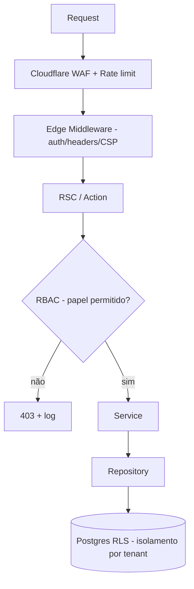

> **Regra:** autorização é verificada em **duas** fronteiras — aplicação (RBAC em
> Services/Actions) e dados (RLS no Postgres). Uma falha de uma não vaza dados
> por causa da outra.

---

## 12. Banco de Dados

Organização **conceitual** das tabelas (sem SQL). Reflete as entidades do
Business Architecture (§6). Persistência em PostgreSQL/Supabase, com RLS por tenant.

### 12.1 Relacionamentos

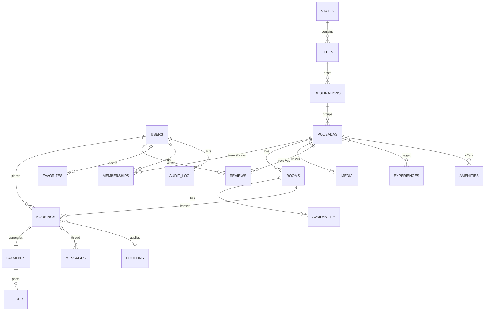

### 12.2 Grupos de tabelas

| Grupo | Tabelas | Observações |
|---|---|---|
| **Identidade** | `users`, `profiles`, `memberships`, `roles` | `memberships` liga usuário↔pousada com papel (multi-tenant) |
| **Geografia** | `states`, `cities`, `destinations`, `regions` | Catálogo curado; base de busca |
| **Catálogo** | `pousadas`, `rooms`, `media`, `experiences`, `amenities`, `pousada_experiences`, `pousada_amenities` | N:N via tabelas de junção |
| **Inventário** | `availability` | Estoque por `room` × `date`; índice composto |
| **Transação** | `bookings`, `payments`, `coupons`, `ledger` | `ledger` = lançamentos financeiros/repasses |
| **Social** | `reviews`, `favorites`, `messages`, `notifications` | Reviews verificados (só estadia concluída) |
| **Governança** | `audit_log`, `feature_flags`, `settings` | Trilha de auditoria e configuração |

### 12.3 Diretrizes de modelagem

| Diretriz | Motivo |
|---|---|
| Chaves UUID | Distribuído, sem colisão, não enumerável |
| `tenant_id`/`pousada_id` em tabelas de oferta | Base do isolamento por RLS |
| Índices em busca/disponibilidade | Latência de busca em escala |
| Particionamento de `bookings`/`payments` por período | Volume de 100M+ |
| Soft delete + `audit_log` | Rastreabilidade e conformidade |
| Timestamps `created_at`/`updated_at` | Auditoria e cache/revalidate |

---

## 13. Integrações

Toda integração fica atrás de uma **abstração** em `services/` (interface) com
implementação isolada — trocável sem afetar a UI.

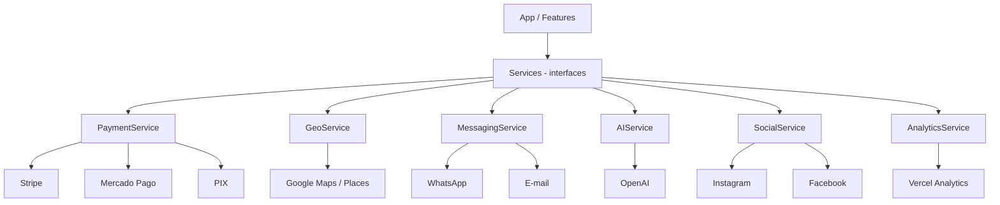

| Integração | Abstração | Uso | Isolamento |
|---|---|---|---|
| Stripe / Mercado Pago / PIX | `PaymentService` | Cobrança, split, payout, reembolso | Webhooks idempotentes; segredos server-side |
| Google Maps / Places | `GeoService` | Geocode, autocomplete, mapa | Chave restrita por domínio |
| WhatsApp / E-mail | `MessagingService` | Notificações e atendimento | Templates versionados; filas |
| OpenAI / LLM | `AIService` | Concierge, copiloto, moderação | Ver §15; sem PII sensível no prompt |
| Instagram / Facebook | `SocialService` | Login social, catálogo, marketing | OAuth; escopos mínimos |
| Vercel Analytics | `AnalyticsService` | Web vitals, eventos de produto | Sem PII; consentimento |

> **Regra:** webhooks de pagamento são **idempotentes** e verificados por
> assinatura; efeitos colaterais (e-mail, payout) rodam em fila, nunca no caminho
> síncrono do checkout.

---

## 14. Observabilidade

Instrumentação técnica e de negócio para operar em escala.

| Pilar | Ferramenta/Padrão | O que captura |
|---|---|---|
| **Logs** | Estruturados (JSON) + Sentry | Erros, contexto, correlação por request id |
| **Tracing** | Sentry Performance / OpenTelemetry | Traço UI→Action→Service→Repo→DB |
| **Performance** | Vercel Analytics + Web Vitals | LCP, INP, CLS por rota |
| **Business metrics** | Eventos de domínio | GMV, conversão, ocupação, take rate |
| **Alerts** | Limiares + on-call | Erros, latência, falha de pagamento/webhook |
| **Audit** | `audit_log` | Ações sensíveis: ator, ação, alvo, timestamp, motivo |

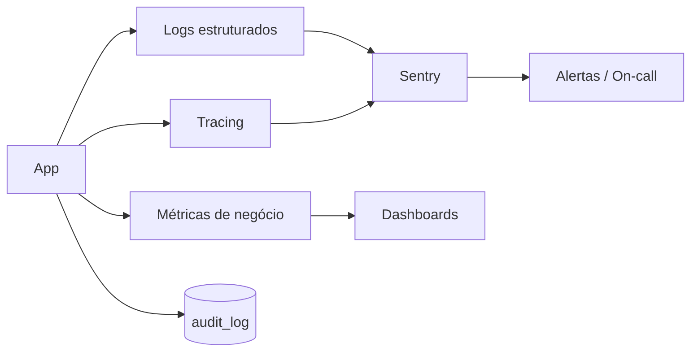

**Regra:** todo erro tem correlation id; toda ação sensível gera evento de
auditoria; métricas de negócio são tratadas com o mesmo rigor das técnicas.

---

## 15. Estratégia de IA

Cada IA é um **agente isolado**, atrás de `AIService`, com escopo próprio,
prompts versionados e _humano no circuito_ para ações sensíveis (ver AI_RULES e
Princípios de Produto).

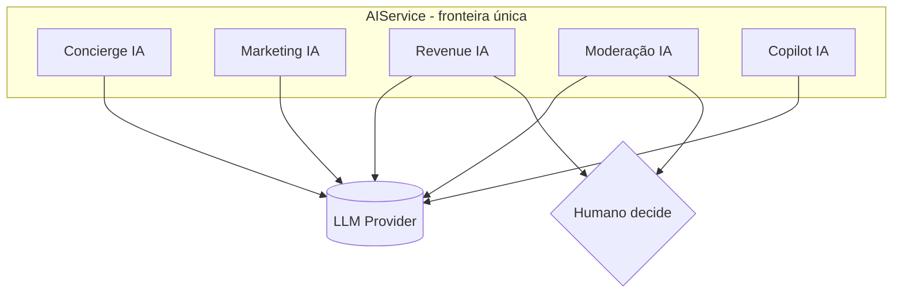

| Agente | Público | Função | Guardrails |
|---|---|---|---|
| **Concierge IA** | Viajante | Recomendação, planejamento de rota | Sem PII sensível; só dados públicos/consentidos |
| **Marketing IA** | Proprietário | Geração de campanhas/descrições | Rascunho; publicação exige humano |
| **Revenue IA** | Proprietário | Sugestão de precificação dinâmica | Sugere; nunca altera tarifa sozinha |
| **Moderação IA** | Plataforma | Triagem de conteúdo/denúncias | Remoção definitiva exige revisão humana |
| **Copilot IA** | Equipes | Assistência operacional (suporte etc.) | Ações sensíveis logadas + confirmadas |

**Padrões:** prompts e políticas versionados; entradas/saídas validadas; custo e
latência monitorados; _fallback_ gracioso quando o provedor falha; nenhuma IA
executa pagamento, aprovação irreversível ou punição sozinha.

---

## 16. Multi-Tenant

Isolamento rígido entre pousadas (tenants), usuários e plataforma. **Zero
vazamento de dados** é requisito não-negociável.

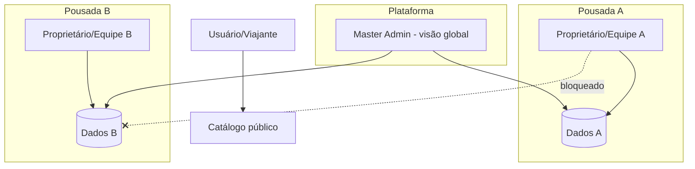

| Escopo | Isolamento |
|---|---|
| **Usuário/Viajante** | Vê só as próprias reservas, mensagens e favoritos |
| **Pousada (tenant)** | `memberships` define acesso; RLS filtra por `pousada_id` |
| **Equipe da pousada** | Papéis (Proprietário/Admin/Recepção/Financeiro) com RBAC dentro do tenant |
| **Plataforma/Master** | Acesso global com auditoria; menor privilégio + duplo controle em ações críticas |

**Mecanismos:** `tenant_id`/`pousada_id` em todas as tabelas de oferta; **RLS**
como última linha de defesa (mesmo com bug de aplicação, o banco recusa acesso
cruzado); RBAC na aplicação; testes automatizados de isolamento.

---

## 17. Escalabilidade

Arquitetura preparada para **100k pousadas · 10M usuários · 100M+ reservas** sem
reescrita. As decisões abaixo são estruturais, não otimizações tardias.

| Dimensão | Estratégia técnica |
|---|---|
| **Catálogo (100k)** | SSG + ISR por slug; geração sob demanda + revalidate; sem build gigante |
| **Busca** | Índice dedicado (Postgres FTS → Meilisearch/Typesense/Algolia); facetas por experiência/região |
| **Leitura (10M usuários)** | RSC + CDN + cache multi-camada; estado de client mínimo |
| **Escrita (100M reservas)** | Actions idempotentes; filas para efeitos colaterais; particionamento por período |
| **Inventário** | Estoque por data com locks curtos e idempotência; sem overbooking |
| **Banco** | Índices, particionamento, read replicas; consultas só via `repositories` |
| **Pagamentos** | Split/payout assíncronos, reconciliação por eventos, webhooks idempotentes |
| **Multi-região (futuro)** | Edge + réplicas regionais; dados por região de residência |
| **Custo** | Cache agressivo + imagens em CDN → custo marginal por página tende a zero |

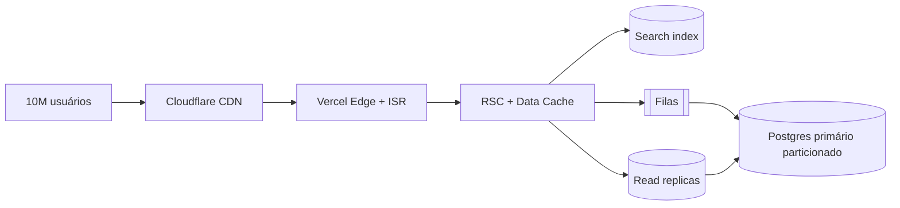

**Princípio:** escalar é **adicionar** peças previstas (índice de busca, réplicas,
filas), nunca reescrever camadas. Os contratos de `services`/`repositories`
absorvem a mudança.

---

## 18. Convenções

Regras obrigatórias (complementam `CodingStandards.md`). Consistência habilita
IA e humanos a navegar o código sem surpresas.

| Item | Convenção | Exemplo |
|---|---|---|
| **Arquivos** | `kebab-case` | `pousada-detail.tsx`, `use-scrolled.ts` |
| **Componentes** | `PascalCase`; um por responsabilidade | `PousadaDetail`, `StatCard` |
| **Actions** | verbo no infinitivo; sufixo por contexto; `'use server'` | `createBooking`, `cancelBooking` |
| **Hooks** | prefixo `use`; client | `useAvailability`, `useToast` |
| **Services** | `nome.service.ts`; funções assíncronas; `server-only` | `bookings.service.ts` → `listBookings()` |
| **Repositories** | `nome.repository.ts`; só consultas | `bookings.repository.ts` |
| **Schemas** | Zod; `nome.schema.ts`; `Input`/`Output` | `bookingSchema`, `CreateBookingInput` |
| **Types** | `PascalCase`; domínio em `types/` | `Pousada`, `Booking`, `Paginated<T>` |
| **Imports** | absolutos via alias `@/*` | `@/features/reservas` |
| **Barrels** | `index.ts` como superfície pública | `export { ... } from './...'` |
| **Alias** | `@/*` → raiz | configurado no `tsconfig` |
| **Actions retorno** | sempre `ActionResult<T>` | `{ ok, data | error }` |
| **CSS** | só tokens + Design System; `cn()` para classes | sem hex/estilo inline |

**Ordem de imports:** externos → aliases (`@/`) → relativos. **Nunca** importar
arquivos internos de outra feature (só o barrel).

---

## 19. Fluxos Técnicos

### 19.1 Login

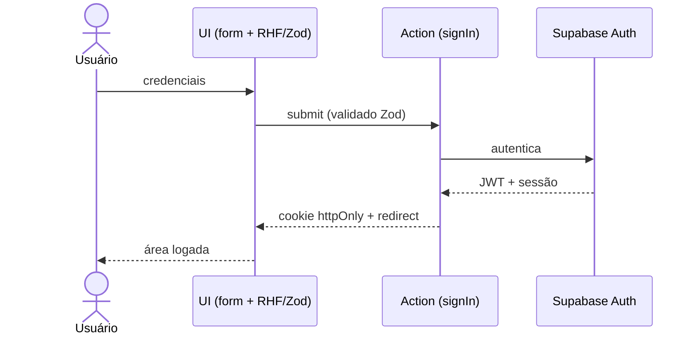

### 19.2 Reserva

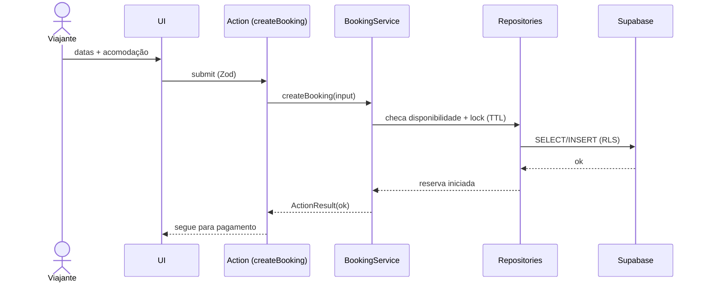

### 19.3 Pagamento

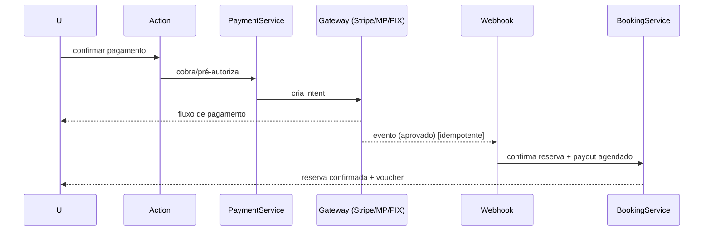

### 19.4 Busca

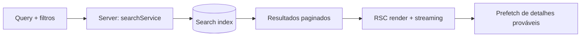

### 19.5 Dashboard

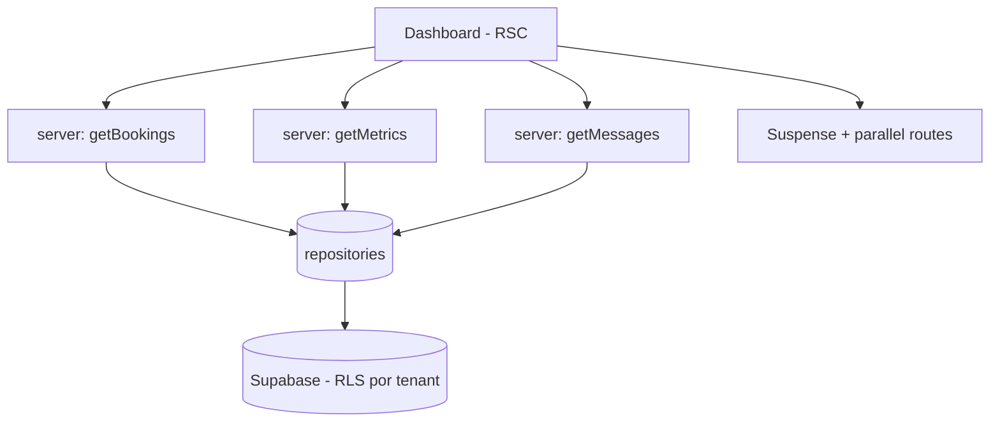

### 19.6 Publicação da pousada

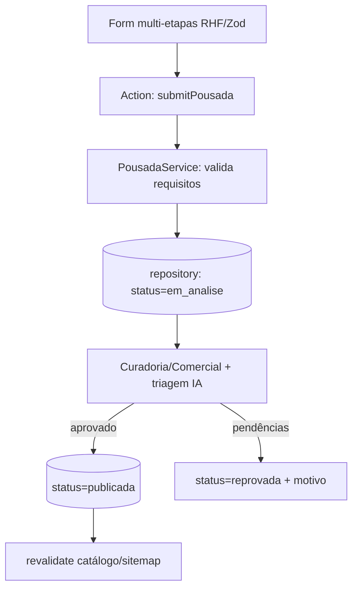

### 19.7 Chat

```mermaid
sequenceDiagram
    actor H as Hóspede
    participant UI as UI (realtime)
    participant SB as Supabase Realtime
    participant P as Pousada
    H->>UI: envia mensagem
    UI->>SB: insert (RLS por reserva)
    SB-->>P: evento realtime
    P-->>UI: resposta
    UI-->>H: thread atualizada
```

### 19.8 Avaliação

```mermaid
flowchart TD
    CO[Check-out concluído] --> EN[Habilita avaliação - até 14 dias]
    EN --> F[Form RHF/Zod]
    F --> A[Action: createReview]
    A --> S[ReviewService: valida estadia concluída]
    S --> R[(repository: review verificado)]
    R --> REV[revalidate página da pousada]
    R --> RESP[Pousada pode responder 1x]
```

---

## 20. Princípios da Engenharia

Critérios de decisão obrigatórios. Em conflito, prevalecem sobre preferências
individuais.

1. **Feature First** — todo domínio é uma feature isolada e autocontida.
2. **Server Components primeiro** — renderização no servidor por padrão.
3. **Client Components só quando necessário** — estado/efeito/interação real.
4. **Performance é prioridade** — web vitals são requisito, não enfeite.
5. **Mobile First** — projeta-se para o menor viewport primeiro.
6. **Design System obrigatório** — nada de UI fora de `components/ui`.
7. **Código limpo** — nomes claros, funções pequenas, sem duplicação.
8. **Componentização máxima** — uma responsabilidade por componente.
9. **Documentação obrigatória** — nenhuma feature sem doc; nenhum código sem contexto.
10. **Testabilidade** — camadas desacopladas; lógica testável isoladamente.
11. **Escalabilidade** — nenhuma decisão que exija reescrita para crescer.
12. **Segurança por padrão** — menor privilégio, validação total, RBAC + RLS.
13. **Acessibilidade WCAG AA** — toda tela acessível por padrão.

> **Contrato para IA e humanos:** este documento + `AI_RULES.md` +
> `DesignSystem.md` + `DesignFoundations.md` formam a fronteira do que é
> permitido. Alterações estruturais relevantes exigem atualização deste
> documento na mesma entrega. Esta é a **referência técnica definitiva** da
> Rota das Pousadas.

