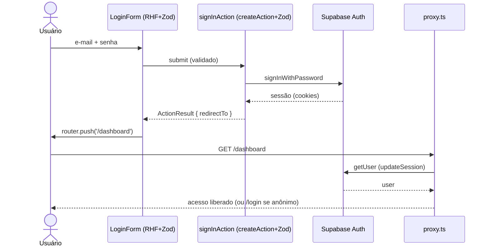

# Feature: Autenticação

Autenticação via **Supabase Auth** (e-mail + senha), seguindo o fluxo obrigatório
do `Architecture.md`. Não há tabela própria de credenciais — o Supabase Auth
gerencia usuários; o app resolve sessão → profile → papéis.

## Camadas (ordem da arquitetura)

| Camada         | Arquivo                                   | Papel                                                                 |
| -------------- | ----------------------------------------- | --------------------------------------------------------------------- |
| Schemas        | `features/auth/schemas.ts`                | `loginSchema`, `signupSchema` (Zod)                                   |
| Types          | `features/auth/types.ts`                  | `SessionUser`, `TenantMembership`                                     |
| Repository     | `repositories/profiles.repository.ts`     | lê `profiles` + `memberships` (papéis)                                |
| Service        | `features/auth/services/auth.service.ts`  | `getCurrentUser()` (sessão + profile)                                 |
| Server Query   | `server/queries.ts` → `getCurrentUser`    | wrapper com cache por request                                         |
| Server Actions | `features/auth/actions.ts`                | `signInAction`, `signUpAction`, `signOutAction`                       |
| Components     | `features/auth/components/*`              | `LoginForm`, `SignupForm`, `LogoutButton` (RHF + Zod + Design System) |
| Páginas        | `app/(auth)/login`, `app/(auth)/cadastro` | grupo de rotas de auth                                                |

## Fluxo

## Segurança

- **Autenticação** no `proxy.ts`: `/dashboard` e `/admin` exigem sessão; anônimo
  é redirecionado para `/login?next=…`.
- **Autorização (RBAC)**: papéis resolvidos em `getCurrentUser`; use `can()` de
  `lib/auth/rbac.ts` para gating fino (ex.: `/admin` exige `platformRole`).
- **RLS** no Postgres é a segunda barreira: mesmo com falha na aplicação, o banco
  recusa acesso cruzado (ver `supabase/migrations/0002_rls.sql`).
- Cookies de sessão são httpOnly (geridos pelo `@supabase/ssr`).

## Setup necessário no Supabase

1. Rodar `supabase/migrations/0003_auth_profiles.sql` (cria o trigger que gera o
   `profile` automaticamente a cada cadastro).
2. **Authentication → Providers → Email**: para testes rápidos, desabilitar
   "Confirm email"; caso contrário, o usuário precisa confirmar o e-mail antes de
   entrar (o formulário de cadastro já exibe essa mensagem).

## Próximos passos

- Enforce de papel em `/admin` (exigir `platformRole`) via layout server + `can()`.
- Recuperação de senha (`resetPasswordForEmail`) e login social (OAuth).
- Onboarding: vincular `memberships` ao criar/pleitear uma pousada.
