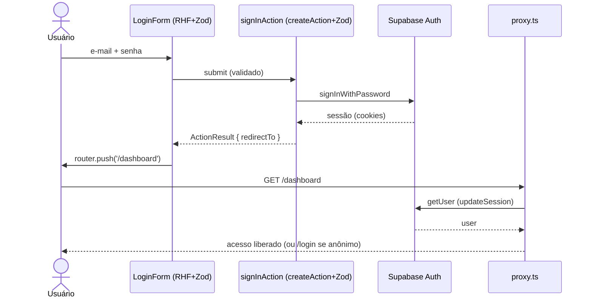

# Feature: Autenticação

Autenticação via **Supabase Auth** (e-mail + senha), seguindo o fluxo obrigatório
do `Architecture.md`. Não há tabela própria de credenciais — o Supabase Auth
gerencia usuários; o app resolve sessão → profile → papéis.

## Camadas (ordem da arquitetura)

| Camada         | Arquivo                                   | Papel                                                                 |
| -------------- | ----------------------------------------- | --------------------------------------------------------------------- |
| Schemas        | `features/auth/schemas.ts`                | `loginSchema`, `signupSchema` (Zod)                                   |
| Types          | `features/auth/types.ts`                  | `SessionUser`, `TenantMembership`                                     |
| Repository     | `repositories/profiles.repository.ts`     | lê `profiles` + `memberships` (papéis)                                |
| Service        | `features/auth/services/auth.service.ts`  | `getCurrentUser()` (sessão + profile)                                 |
| Server Query   | `server/queries.ts` → `getCurrentUser`    | wrapper com cache por request                                         |
| Server Actions | `features/auth/actions.ts`                | `signInAction`, `signUpAction`, `signOutAction`                       |
| Components     | `features/auth/components/*`              | `LoginForm`, `SignupForm`, `LogoutButton` (RHF + Zod + Design System) |
| Páginas        | `app/(auth)/login`, `app/(auth)/cadastro` | grupo de rotas de auth                                                |

## Fluxo

## Segurança

- **Autenticação** no `proxy.ts`: `/dashboard` e `/admin` exigem sessão; anônimo
  é redirecionado para `/login?next=…`.
- **Autorização (RBAC)**: papéis resolvidos em `getCurrentUser`; use `can()` de
  `lib/auth/rbac.ts` para gating fino (ex.: `/admin` exige `platformRole`).
- **RLS** no Postgres é a segunda barreira: mesmo com falha na aplicação, o banco
  recusa acesso cruzado (ver `supabase/migrations/0002_rls.sql`).
- Cookies de sessão são httpOnly (geridos pelo `@supabase/ssr`).

## Setup necessário no Supabase

1. Rodar `supabase/migrations/0003_auth_profiles.sql` (cria o trigger que gera o
   `profile` automaticamente a cada cadastro).
2. **Authentication → Providers → Email**: para testes rápidos, desabilitar
   "Confirm email"; caso contrário, o usuário precisa confirmar o e-mail antes de
   entrar (o formulário de cadastro já exibe essa mensagem).

## Próximos passos

- Enforce de papel em `/admin` (exigir `platformRole`) via layout server + `can()`.
- Recuperação de senha (`resetPasswordForEmail`) e login social (OAuth).
- Onboarding: vincular `memberships` ao criar/pleitear uma pousada.

## Nomes na tela de Membros (0068)

- A RLS de `profiles` só deixa cada usuário ler o próprio perfil, e a tela de
  Membros lia os nomes direto da tabela: o dono via o próprio nome e o resto
  da equipe aparecia como "Sem nome".
- `list_membership_names(pousada)` devolve só usuário e nome dos membros da
  pousada, e só para quem a gerencia (`auth_can_manage_pousada`), no mesmo
  desenho de `list_membership_emails` (0017). A tabela `profiles` segue
  fechada.
- Testes: `supabase/tests/priorities.sql` e
  `repositories/memberships.repository.test.ts`.
- Rollback: `supabase/rollback/0068_rollback.sql`.

## Excluir a própria conta (0090)

- Caminho: `/conta` → "Excluir minha conta" (digitar o próprio e-mail) →
  `deleteMyAccountAction` → `features/auth/services/account-deletion.service.ts`.
  Página pública com o passo a passo: `/excluir-conta` (exigência da Google
  Play). Depois de excluir: `/conta-excluida`.
- Decisão (topo de `supabase/migrations/0090_excluir_conta.sql`): **anonimizar,
  não apagar linhas**. ~30 chaves estrangeiras `NO ACTION` apontam para
  `profiles` (reservas, avaliações, auditoria, comprovantes); apagar o usuário
  do Auth seria recusado pelo banco ou exigiria reescrever a trilha da pousada.
- `delete_my_account()` (só `authenticated`, sempre `auth.uid()`): recusa
  reserva pendente/confirmada/em estadia com checkout >= hoje (fuso da pousada),
  dono de pousada não encerrada e papel de plataforma; apaga perfil de viajante,
  favoritos, alertas, equipe/convites e tentativas de login; desvincula fichas
  (`guests.user_id`) e reservas (`bookings.guest_id`); transforma `profiles` em
  lápide ("Conta excluída", `deleted_at`); grava `account.deleted` sem dado
  pessoal. Idempotente.
- Depois da RPC, o servidor chama `auth.admin.deleteUser(id, true)` (soft
  delete do Supabase: ofusca e-mail e telefone, apaga senha, nome, identidades
  e sessões; o e-mail fica livre para um cadastro novo).
- Testes: `supabase/tests/excluir-conta.sql`,
  `features/auth/services/account-deletion.service.test.ts`,
  `repositories/account-deletion.repository.test.ts`,
  `features/auth/account-deletion.test.ts`.
- Rollback: `supabase/rollback/0090_rollback.sql`.
