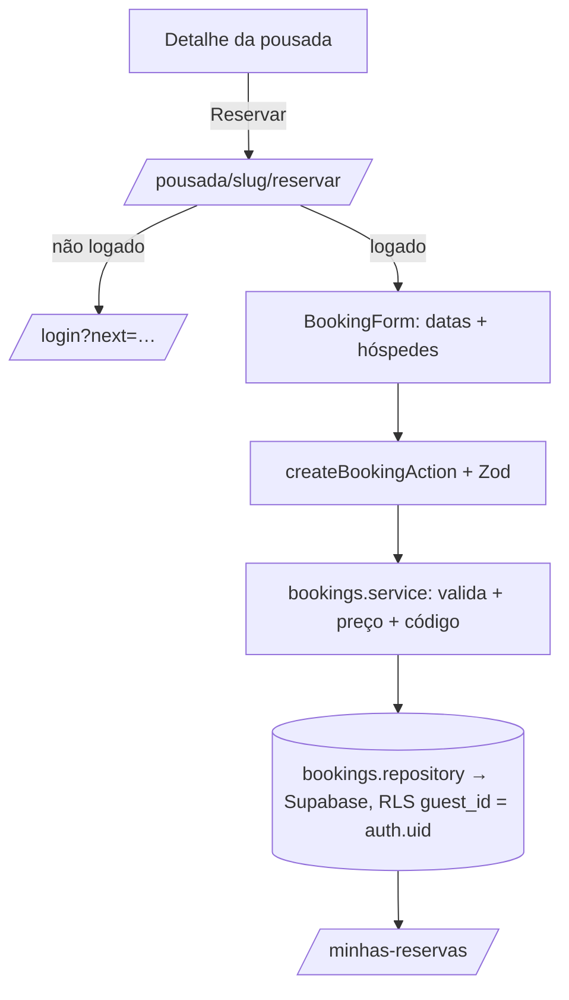

# Feature: Reservas

Reserva de pousadas por hóspedes autenticados, seguindo o fluxo obrigatório do
`Architecture.md`. Cria uma reserva com preço congelado no ato; a confirmação
ocorrerá após o pagamento (feature futura), então a reserva nasce como
`aguardando_pagamento` (RB-20..23).

## Camadas (ordem da arquitetura)

| Camada | Arquivo | Papel |
|---|---|---|
| Schemas | `features/reservas/schemas.ts` | `createBookingSchema` (Zod: datas, hóspedes) |
| Types | `features/reservas/types.ts` | `Booking`, `BookingStatus`, `PriceBreakdown` |
| Pricing | `features/reservas/pricing.ts` | cálculo puro (diária × noites + 8% taxa) — testável |
| Repository | `repositories/rooms.repository.ts`, `repositories/bookings.repository.ts` | única porta ao banco |
| Service | `features/reservas/services/bookings.service.ts` | regras: auth, capacidade, período, código, persistência |
| Server Query | `server/queries.ts` → `getMyBookings`, `getBookableRoom` | wrappers com cache |
| Server Action | `features/reservas/actions.ts` | `createBookingAction` (Zod → ActionResult) |
| Components | `features/reservas/components/booking-form.tsx` | formulário RHF + Zod + Design System |
| Páginas | `app/pousada/[slug]/reservar`, `app/minhas-reservas` | fluxo de reserva + lista |

## Fluxo

## Regras aplicadas

- **Autenticação obrigatória** (proxy protege `/minhas-reservas`; a página de
  reservar redireciona anônimos para `/login`; o service recusa sem sessão).
- **Capacidade**: hóspedes ≤ capacidade da acomodação.
- **Período**: check-out > check-in, sem datas no passado, mínimo 1 noite.
- **Preço congelado**: `subtotal = diária × noites`, `taxa = 8%`, `total`
  calculados server-side no ato e gravados na reserva.
- **Isolamento (RLS)**: `bookings_insert` exige `guest_id = auth.uid()`;
  `bookings_read` limita ao hóspede dono (ou equipe da pousada).

## Setup de banco necessário

Rodar no Supabase (SQL Editor), em ordem:
- `supabase/migrations/0004_rooms_seed.sql` — cria 1 acomodação por pousada
  publicada (necessário para reservar).

## Próximos passos

- **Pagamentos**: confirmar reserva (`confirmada`) após aprovação (Stripe/PIX);
  hoje fica `aguardando_pagamento`.
- **Disponibilidade real**: bloquear datas já reservadas (tabela `availability`)
  e impedir overbooking (RB-13).
- **Cancelamento/reembolso** conforme política (RB-30..34).
- **Seleção de acomodação**: hoje usa a acomodação padrão; múltiplos quartos por
  pousada virão com o dashboard do proprietário.

## Check-in e check-out (0048)

- Transições `confirmed → checked_in → checked_out` em `set_booking_status`
  (migration `0048_booking_checkin_checkout.sql`), espelhadas em
  `features/reservas/status.ts` e `features/gestao/schemas.ts`.
- Só equipe da pousada (`checkin:perform` / `checkout:perform` na matriz RBAC;
  no banco, `auth_has_guest_access`). Plataforma só com concessão ativa (0047).
- Check-in só a partir da data de entrada, no fuso da pousada
  (`pousadas.timezone`, padrão `America/Sao_Paulo`). O botão no painel já
  fica desabilitado antes disso; a regra de verdade é a RPC.
- Check-out não tem restrição de data (saída antecipada é operação normal).
- Rastreabilidade em `bookings.checked_in_at/by` e `checked_out_at/by`;
  auditoria `booking.checked_in` / `booking.checked_out`.
- Rollback: `supabase/rollback/0048_rollback.sql`.
