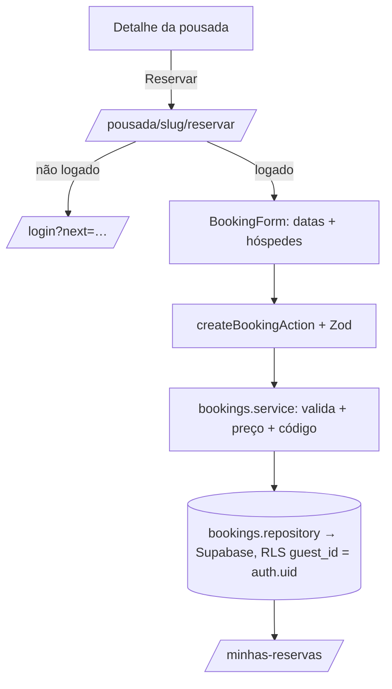

# Feature: Reservas

Reserva de pousadas por hóspedes autenticados, seguindo o fluxo obrigatório do
`Architecture.md`. Cria uma reserva com preço congelado no ato; a confirmação
ocorrerá após o pagamento (feature futura), então a reserva nasce como
`aguardando_pagamento` (RB-20..23).

## Camadas (ordem da arquitetura)

| Camada        | Arquivo                                                                   | Papel                                                   |
| ------------- | ------------------------------------------------------------------------- | ------------------------------------------------------- |
| Schemas       | `features/reservas/schemas.ts`                                            | `createBookingSchema` (Zod: datas, hóspedes)            |
| Types         | `features/reservas/types.ts`                                              | `Booking`, `BookingStatus`, `PriceBreakdown`            |
| Pricing       | `features/reservas/pricing.ts`                                            | cálculo puro (diária × noites + 8% taxa) — testável     |
| Repository    | `repositories/rooms.repository.ts`, `repositories/bookings.repository.ts` | única porta ao banco                                    |
| Service       | `features/reservas/services/bookings.service.ts`                          | regras: auth, capacidade, período, código, persistência |
| Server Query  | `server/queries.ts` → `getMyBookings`, `getBookableRoom`                  | wrappers com cache                                      |
| Server Action | `features/reservas/actions.ts`                                            | `createBookingAction` (Zod → ActionResult)              |
| Components    | `features/reservas/components/booking-form.tsx`                           | formulário RHF + Zod + Design System                    |
| Páginas       | `app/pousada/[slug]/reservar`, `app/minhas-reservas`                      | fluxo de reserva + lista                                |

## Fluxo

## Regras aplicadas

- **Autenticação obrigatória** (proxy protege `/minhas-reservas`; a página de
  reservar redireciona anônimos para `/login`; o service recusa sem sessão).
- **Capacidade**: hóspedes ≤ capacidade da acomodação.
- **Período**: check-out > check-in, sem datas no passado, mínimo 1 noite.
- **Preço congelado**: `subtotal = diária × noites`, `taxa = 8%`, `total`
  calculados server-side no ato e gravados na reserva.
- **Isolamento (RLS)**: `bookings_insert` exige `guest_id = auth.uid()`;
  `bookings_read` limita ao hóspede dono (ou equipe da pousada).

## Setup de banco necessário

Rodar no Supabase (SQL Editor), em ordem:

- `supabase/migrations/0004_rooms_seed.sql` — cria 1 acomodação por pousada
  publicada (necessário para reservar).

## Próximos passos

- **Pagamentos**: confirmar reserva (`confirmada`) após aprovação (Stripe/PIX);
  hoje fica `aguardando_pagamento`.
- **Disponibilidade real**: bloquear datas já reservadas (tabela `availability`)
  e impedir overbooking (RB-13).
- **Cancelamento/reembolso** conforme política (RB-30..34).
- **Seleção de acomodação**: hoje usa a acomodação padrão; múltiplos quartos por
  pousada virão com o dashboard do proprietário.

## Check-in e check-out (0048)

- Transições `confirmed → checked_in → checked_out` em `set_booking_status`
  (migration `0048_booking_checkin_checkout.sql`), espelhadas em
  `features/reservas/status.ts` e `features/gestao/schemas.ts`.
- Só equipe da pousada (`checkin:perform` / `checkout:perform` na matriz RBAC;
  no banco, `auth_has_guest_access`). Plataforma só com concessão ativa (0047).
- Check-in só a partir da data de entrada, no fuso da pousada
  (`pousadas.timezone`, padrão `America/Sao_Paulo`). O botão no painel já
  fica desabilitado antes disso; a regra de verdade é a RPC.
- Check-out não tem restrição de data (saída antecipada é operação normal).
- Rastreabilidade em `bookings.checked_in_at/by` e `checked_out_at/by`;
  auditoria `booking.checked_in` / `booking.checked_out`.
- Rollback: `supabase/rollback/0048_rollback.sql`.

## Ficha FNRH imprimível

- Sem migration — só código. `/dashboard/reservas/[id]/fnrh` monta a Ficha
  Nacional de Registro de Hóspedes a partir do que já está cadastrado:
  reserva (`bookings`), perfil completo do hóspede responsável (`guests`,
  não o snapshot de `bookings.guest_name/email/phone`) e acompanhantes
  (`booking_guests`).
- Campos que o negócio não rastreia hoje (profissão, procedência, próximo
  destino, meio de transporte, placa do veículo) entram em branco na ficha
  impressa — preenchimento manual no check-in, prática comum com o
  formulário do Ministério do Turismo.
- Mesma barreira de `getOwnerReservationDetail`: `getBookingFnrh`
  (`server/queries.ts`) exige `booking:manage`, então quem confere a
  reserva também imprime a ficha (proprietário, gestor, recepção).
- Página fora do `DashboardShell` de propósito (sem menu para não ir para o
  papel); botão "Imprimir ficha FNRH" no detalhe da reserva abre em nova
  aba. Impressão é `window.print()` puro — sem geração de PDF no servidor.
- Repositório: `getBookingFnrhData` (`repositories/bookings.repository.ts`).
  Componentes: `features/reservas/components/fnrh-print-view.tsx`,
  `print-button.tsx`, `guest-type-labels.ts`.

## Expiração automática de pré-reserva (0050)

- Até aqui só existia o botão manual "Expirar" (`expire_pending_booking`,
  migration 0034) — uma reserva `pending` com `payment_due_at` vencido ficava
  travada até alguém abrir aquela reserva específica e clicar; na prática
  ninguém faz isso, e o quarto continua "ocupado" por uma reserva que nunca
  vai pagar.
- Nova RPC `expire_overdue_pending_bookings()` (sem parâmetros) cancela em
  lote toda `pending` vencida, de todas as pousadas — precisa ser assim
  porque quem chama é o cron, sem sessão de usuário e sem tenant. Por isso é
  uma RPC **diferente** da manual, não uma variação dela: só `service_role`
  pode executar (mesmo padrão de `sync_channel_events`/
  `list_channel_feeds_to_import`, 0044), nunca `authenticated`.
- Continua sendo ação explícita e auditada (RB seção 9: nunca expira
  silenciosamente) — a "ação" é o cron rodando, não um clique; a auditoria
  grava `actor_id = null` e `metadata.source = 'cron'`, para nunca ser
  confundida com uma expiração manual (que não tem esse campo).
- Disparada por `/api/cron/expiracao` (`vercel.json`, diário — mesmo limite
  de plano Hobby do cron de canais), protegida pelo mesmo `CRON_SECRET` de
  `/api/cron/canais`. Repositório: `expireOverduePendingBookingsRpc`
  (`repositories/bookings.repository.ts`, via `createSupabaseServiceRoleClient`).
  Serviço: `features/reservas/services/expire-overdue.service.ts`.
- Rollback: `supabase/rollback/0050_rollback.sql` (só remove a RPC — nenhuma
  coluna nova).

## Completar nome no cadastro (reserva pública)

- `createBooking` (`bookings.service.ts`) exige `user.name.trim().length >= 2`
  antes de chamar `ensureTravelerGuestRpc` — sem nome, a pousada receberia uma
  reserva anônima. Cadastro pelo `/entrar` já exige nome (`signupSchema`,
  min. 2 caracteres) e ele vai para `user_metadata.full_name`
  (`getCurrentUser` usa isso como fallback quando `profiles.full_name` está
  vazio); contas sem nome só acontecem fora desse fluxo (conta de teste
  criada direto no Supabase, por exemplo) — mas até 16/09 não havia NENHUMA
  tela para corrigir isso: o erro aparecia e travava ali, sem saída.
- `BookingForm` agora detecta essa mensagem específica e troca o erro
  genérico por um mini-formulário inline (nome + "Salvar nome e continuar"),
  que chama `updateMyNameAction` (`features/auth/actions.ts` →
  `updateMyName` → `repositories/profiles.repository.ts#updateProfileName`)
  e, no sucesso, tenta a reserva de novo automaticamente.
- `updateProfileName` faz `update` (não upsert) em `profiles` — a RLS
  `profiles_self_update` (0002) só permite alterar a própria linha e não há
  policy de insert. Se a linha não existir (não deveria: o projeto assume
  que o cadastro sempre cria uma), o update afeta zero linhas e a função
  lança um erro explícito em vez de falhar calado.

## Página de pagamento (16/09/2026, corrigido em 17/09/2026)

- `createBookingAction` sempre redirecionou para
  `/pousada/[slug]/reservar/[id]/pagamento`. Diagnóstico original (16/09)
  achou que essa página não existia; estava errado — já existia uma página
  em `[bookingId]/pagamento/page.tsx` (nome de parâmetro diferente do usado
  no redirect) que fazia `redirect()` imediato para o Checkout Pro do
  Mercado Pago assim que a preferência era criada. Ou seja, o fluxo público
  já funcionava; só não tinha uma tela de resumo antes de sair para o
  Mercado Pago.
- Criada `app/pousada/[slug]/reservar/[id]/pagamento/page.tsx` — mesma rota
  que o `createBookingAction` já usa — com uma tela de resumo (dados da
  reserva + botão "Pagar agora") em vez do redirect imediato, seguindo a
  escolha do cliente por essa versão mais completa.
- Isso deixou duas páginas apontando pro mesmo padrão de rota
  (`[bookingId]` e `[id]` na mesma posição), o que o Next.js rejeita no
  build ("Ambiguous app routes detected") — pego pela Vercel, não em dev
  local. Corrigido removendo `[bookingId]/pagamento/page.tsx`: nada no
  código linkava para ela com esse nome de parâmetro (só o `[id]` é
  alcançável a partir do `createBookingAction`), então era código órfão.
- A página busca a reserva em `getMyBookings()` (já escopada ao hóspede
  logado) e, se ela ainda está `pending` com saldo devedor, chama
  `getBookingCheckout` (`server/queries.ts` → `createCheckoutPreference`,
  `features/pagamentos/services/checkout.service.ts`) para gerar o link de
  Checkout Pro do Mercado Pago **da própria pousada** (sem split — ver
  `checkout.service.ts`). O botão "Pagar agora" leva direto para esse link.
- Se a pousada ainda não conectou a conta do Mercado Pago (ou qualquer outra
  condição do `createCheckoutPreference` falhar), a página não trata como
  erro fatal: a reserva já existe e está garantida até `payment_due_at`, só
  mostra "pagamento a combinar" em vez do botão. Reservas em outros status
  (confirmada, cancelada, etc.) mostram uma nota correspondente, sem botão.
- O Mercado Pago já está configurado (`checkout.service.ts`) para trazer o
  hóspede de volta para `/minhas-reservas` depois do pagamento (sucesso,
  pendente ou falha) — essa página já existia e já lista todas as reservas
  do hóspede com datas, valores e status, sem mudança necessária nela.
- Sem migration — só código novo (`server/queries.ts#getBookingCheckout` +
  a página) e a remoção da página órfã.
